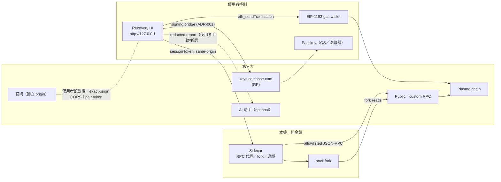
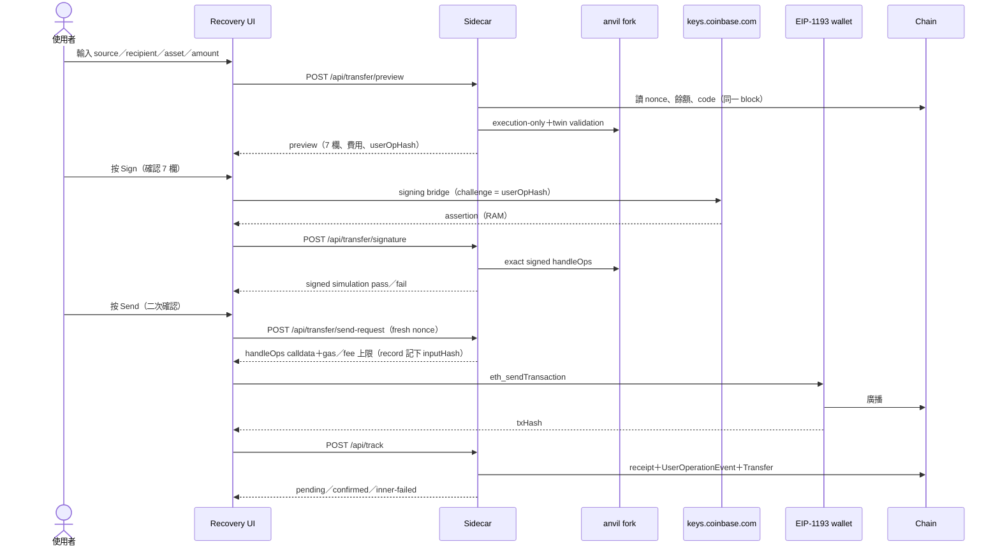
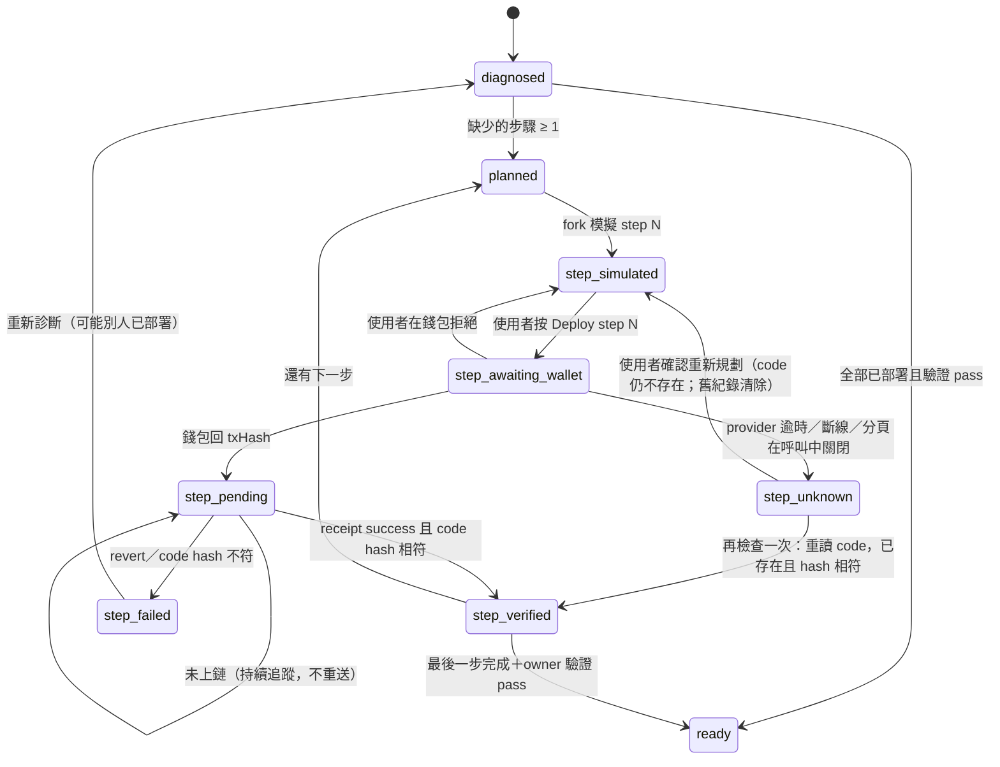
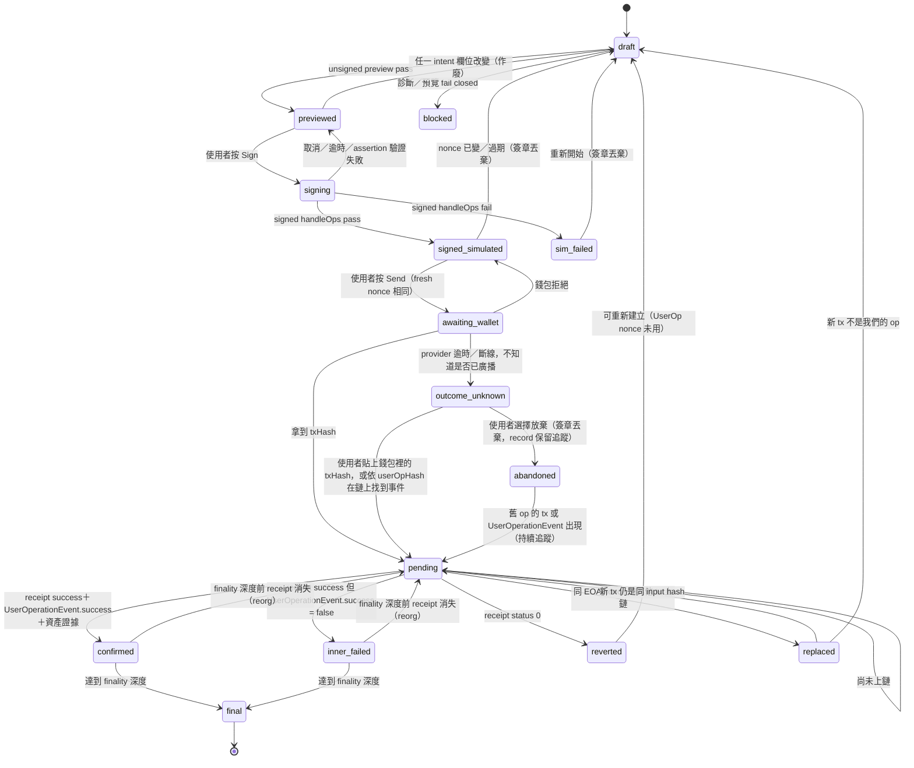

# Passkey Recovery by sd0x — Security & Architecture（規劃）

> **Doc class**: Lifecycle — Phase 3 architecture（current authority）。M3／M4 已實作（2026-10-31）；實作與本文件規劃不同之處以 §0 為準。
> 上游：[2-tech-spec.md](./2-tech-spec.md) · 決策：[adr-001-no-console-signing.md](./adr-001-no-console-signing.md)

## 0. 實作對照（2026-10-31）

| 本文件規劃 | 實作 | 理由 |
|------------|------|------|
| `verifyFromRecord`（§5.3） | `server/track.ts` `track()`：無狀態，只吃瀏覽器保存的 record | 同規劃；名稱不同 |
| TrackingRecord（§6.3）存收款地址雜湊與縮寫 | 收款地址同規劃：只存 `recipientHash`（keccak256）與 `recipientShort`；tracker 比對 mined op 解碼後收款地址的雜湊。sender 也只存 digest＋縮寫，gas wallet 只存 digest；不存 `expectedFromHash`、`intentHash`（固定 key `cbpr.tracking.v1`，最多 20 筆；滿了時不刪舊紀錄、拒絕新的送出，讀寫都過 allowlist，舊格式讀取時轉換並回寫） | 讀鏈上 nonce 所需的完整地址在輪詢時由頁面以 hint 提供（digest 相符才附、sidecar 再驗），不落地。簽章、assertion、signed UserOp、RPC URL 仍永不持久化 |
| 追蹤狀態 `outcome_unknown`、`replaced` 等 | `pending`、`unknown`、`mismatch`、`reverted`、`inner-failed`、`confirmed`、`final`、`reorged` | 以 op（userOpHash＋解碼後 intent／nonce）判定：另一筆交易帶上同一份 op 時照常確認並註明；不含此 op 的交易是 `mismatch`，找不到時繼續 `unknown`，不另設狀態 |
| DeployStepRecord（§6.4）持久化 | 每個帳戶最多一筆**進行中**的部署送出（`cbpr.deploy.v1`：`accountHash`、`gasWalletHash`、步驟 key、txHash），呼叫錢包前寫入並讀回確認（寫不進去就不呼叫錢包）；完成狀態仍每次從鏈上重新規劃，重新規劃成功前紀錄不清除 | 鏈上 code 是完成與否的唯一真相；紀錄只用來在重新整理後繼續追蹤已送出的那一步、不再把它當成新步驟提供 |
| 送出只經 EIP-1193 | 另有 Terminal hand-off（一次性代碼）作為進階路徑；2026-11-01 起另有瀏覽器 File 與 runner native signer，sidecar 驗證後轉送 signed tx（§9） | 保留 Terminal signer（tech spec §3.5 第 7 步）；INV-005 amendment |

## 1. 原則

| # | 原則 | 對應 |
|---|------|------|
| A1 | 本機優先：UI 與 sidecar 都在使用者自己的機器、loopback | INV-005 |
| A2 | 沒有金鑰的後端：sidecar 只讀、模擬、追蹤 | INV-005 |
| A3 | 人的兩個按鈕：Sign 與 Send 分開，各有自己的確認 | INV-003 |
| A4 | 不可變 intent：任何欄位改變就重來 | INV-001 |
| A5 | Fail closed：不知道就不給簽 | INV-002 |
| A6 | Secret 只在 RAM | INV-004、INV-007 |

## 2. 信任邊界



| 邊界 | 跨越的資料 | 防護 |
|------|-----------|------|
| UI ↔ Sidecar | intent、assertion（RAM）、模擬結果 | Host／Origin allowlist、session token、CSP `default-src 'self'`、`frame-ancestors 'none'`（沿用 `server/http.ts`） |
| Sidecar ↔ RPC | JSON-RPC 讀取 | method allowlist（`server/reader.ts`）、SSRF guard（spec §3.3）、URL 不 log |
| UI ↔ keys.coinbase.com | challenge（出）、assertion（回） | ADR-001 條件：exact origin、top frame、配對、單次 challenge |
| UI ↔ EIP-1193 | `handleOps` calldata | 使用者在錢包內確認；追蹤以 op 為準（userOpHash、解碼後 intent／nonce、receipt 與 `UserOperationEvent`，§5.2），不比對外層 input hash |
| UI ↔ AI | 只有 redacted report | `runbook-ai-collaboration.md`；UI 沒有任何 AI 可呼叫的簽署／送出端點 |
| 官網 ↔ 本機 | 只在使用者自行啟動 runner 並輸入配對代碼後：配對 token、API 呼叫（2026-11-01，§9） | Hosted CSP `connect-src` 只多 `http://127.0.0.1:*`；runner 只接受 exact allowlist origin＋一次性代碼；見 [`5-hosted-local-runner.md`](./5-hosted-local-runner.md) §3 |

**任何網站都不能驅動本機**：sidecar 拒絕非 loopback Host、拒絕非自身 Origin、要求只在自身頁面取得的 session token。2026-11-01 起（[ADR-003](./adr-003-local-runner-pairing.md)、§9）唯一例外是 runner 的配對：exact allowlist origin 的 CORS、一次性代碼換來的短期 token；sidecar 仍不持有金鑰，relay 只轉送它自己 issue、驗證通過的 raw tx。除此之外沒有 CORS 開放，這些防護開源版不放寬。

## 3. 資料流（轉帳）



## 4. 部署狀態機



- **冪等**：deterministic deployment 的地址固定；每一步開始前重讀 code。若 code 已存在且 hash 相符，該步直接 `step_verified`（別人或先前的分頁已完成），不送交易。
- 部署 tx 由 EIP-1193 錢包決定 nonce；UI 不自己指定 EOA nonce，但會記下 txHash 追蹤。每一步在呼叫 `eth_sendTransaction` **之前**先把 `DeployStepRecord`（§6.4）寫入 storage，所以中斷後回來是 `step_unknown`。
- `step_unknown` 可以重新規劃，與轉帳的 `outcome_unknown` 不同：deterministic deployment 的目標地址固定，舊 tx 與新 tx 都上鏈時不會部署到別的地址、也不會移動資產，但各步的結果不同：

| 步驟 | 重複的那一筆會怎樣 | 等級 |
|------|--------------------|------|
| 1 implementation、2 factory（經 Safe singleton factory 的 CREATE2） | 目標地址已有 code，CREATE2 失敗，交易 revert，只損失 gas | Inferred（M3 以 testchain 測試確認） |
| 3 wallet（`factory.createAccount`） | **不會 revert**：v1.1 `createAccount` 在地址已部署時直接回傳既有 account、不再 `initialize`，交易成功但沒有效果，只花 gas | Verified（coinbase/smart-wallet v1.1.0 `CoinbaseSmartWalletFactory.sol` `createAccount` 的 `alreadyDeployed` 分支） |

  所以完成與否**不看哪一筆 receipt 成功**，一律以重讀 code hash（以及第 3 步的 ERC-1967 slot 與 owner 順序）判定。UI 在重新規劃前明示可能多付一次 gas。部署步驟沒有貼上 txHash 的入口，重新規劃也不會在背景繼續追蹤舊 tx：`step_unknown` 只提供「再檢查一次」（從鏈上重讀 code）與「重新規劃」；重新規劃會清除這次嘗試的 deploy record（`clearDeployIf`），之後以鏈上狀態為準——舊 tx 若稍後上鏈，下一次規劃或再檢查會看到 code 已存在而略過該步。

## 5. 轉帳狀態機



**追蹤不會因為狀態變成 abandoned／confirmed 就停止**：record 一律保留並持續輪詢，只有結果不會再變時才停止（`src/ui/trackPoll.ts` `trackSettled`）：`final`；深度已達 finality 的 `inner-failed`；深度已達 finality、帳戶 nonce **在 finality 深度的 block（head − 12）上**已超過該 op、且事件掃描已完成的 `reverted`；以及同樣條件下（掃描完整、沒有這個 op 的 event、nonce 在 finality 深度上已前進）被取代的 `unknown`（`nonceFinal`；只在淺層 block 前進的 nonce 可能被 reorg 退回，讓原 signed op 又能執行；深度上的 nonce 讀不到時為 null，不視為已前進）。其他狀態（含 nonce 只在淺層 block 被用掉、或掃描未完成的 `unknown`）都繼續輪詢，Track 也不提供「從清單移除」：未定案的 record 仍是新 intent gate 的依據。能否開始新 intent 是另一個判斷（`newIntentGate`，見下），不等於停止追蹤。重新整理時，`abandoned` record 以同樣方式恢復成背景追蹤，並在 Track 步驟列出。

**從 `abandoned` 開始新 intent 之前**，先讀舊 record 的狀態與 live UserOp nonce：

| 觀察 | 行為 |
|------|------|
| live nonce == 舊 op 的 nonce（舊 op 尚未執行） | 允許；新 op 用同一個 nonce，兩者鏈上最多只有一份能執行 |
| 舊 op 的 `UserOperationEvent` 已出現（成功或 inner-failed） | 先顯示舊 op 的結果；若成功，**阻止**以「重試」名義建立新 intent，只允許使用者明確選擇「另一筆獨立的新轉帳」並重新輸入 |
| live nonce 已前進、掃描 `complete`（`scanCursor` 已到 head）且沒有舊 op 的事件 | 有其他 op 用掉了 nonce，舊 op 不可能再執行；顯示這一點後允許新 intent |
| live nonce 已前進但掃描 `incomplete` | 舊 op 的結果**未知**：不得推論它沒執行，也不得推論 nonce 被別的 op 用掉；不開放新 intent，直到掃描完成，或使用者貼上 txHash 並通過驗證 |

實作：`src/ui/trackPoll.ts` 的 `newIntentGate` 依上表把每筆 record 分成 `same-nonce`／`executed`／`nonce-used`／`unknown`；`App` 以同一帳戶的全部 record 決定 Move 是否開放（尚無追蹤結果也算 `unknown`）；`nonceAgrees` 再要求新 plan 的 nonce 與各 record 的 gate 一致，preview 先讀到前進的 nonce 時不接受該 plan。

### 5.1 Nonce 與 idempotency

| 項目 | 規則 |
|------|------|
| UserOp nonce | key 0 的 `EntryPoint.getNonce(wallet, 0)`；preview、sign、send-request 三次都讀；不同即作廢 |
| Twin nonce | twin 讀自己的 `getNonce(twinAddr, 0)`（2026-10-31 修正，見回顧紀錄） |
| 重送 | 同一 signed op 只能送一次；`pending`／`outcome_unknown` 期間沒有 Send 按鈕；`outcome_unknown` 永遠不回到可送出狀態 |
| 重複送出的防護 | 沒有跨 plan 的共用冪等索引。防護分三層：(1) sidecar 的 plan 以隨機 `planId` 識別，send-request 依該 plan 的狀態把關（`server/transfer.ts`）：只有 signed simulation 通過的 `signed` plan 可要求送出；已在 `sending` 的 plan 必須先回報錢包結果才可再要求；只有錢包明確拒絕才回到 `signed`（可再送一次），沒有 hash 的結果只能追蹤；(2) send-request 重讀 fresh nonce，不同即作廢；(3) UI 的 `newIntentGate`／`nonceAgrees`（`src/ui/trackPoll.ts`）在舊 record 對帳前不開放新 intent，且新 plan 的 nonce 必須與舊 record 的狀態一致。同 nonce 的恢復流程（放棄 unknown 後另開新 intent）刻意允許：兩份 op 同 nonce，鏈上最多一份能執行 |
| 失效條件 | intent 改變、nonce 改變、chain 改變、RPC 切換、超過 10 分鐘 |

### 5.2 證據（native vs ERC-20）

| 資產 | confirmed 條件 |
|------|----------------|
| Native（XPL） | mined `handleOps` 含相同 `userOpHash` 的 op，解碼後 sender／asset／amount／recipient digest／nonce 與 record 相符 ＋ outer receipt success ＋ block 仍在 canonical chain ＋ 自己的 `UserOperationEvent.success`；收款端餘額差僅作參考（同 block 可能有其他轉入） |
| ERC-20（USDT0） | 以上 ＋ 該 op 自己執行區間內（前一個 `UserOperationEvent`／`BeforeExecution` 之後）恰好一筆 `Transfer(wallet → recipient, amount)` log，來自 token 合約地址 |

判定以 **op** 為準，不以外層交易為準：不比對 outer tx 的 input hash、`from`、`value`。同一份 signed op 可能由另一筆交易（錢包替換、其他 bundler）帶上鏈，tracker 認得它並回報「由另一筆交易帶上鏈」；外層 tx 不是 EntryPoint 的 `handleOps` 或不含此 op 時為 `mismatch`。細節見 `2-tech-spec.md` §3.7。

### 5.3 Reorg 與 pending 恢復

- 顯示確認數；`confirmed` 先標示為「confirmed（N 個區塊）」，達到 chain 設定的 finality 深度前若 receipt 消失，回到 `pending` 並顯示「區塊重組，重新追蹤中」。
- 重新整理、關閉分頁或 sidecar 重啟：從 `localStorage` 的 tracking record（§6.3）恢復 `pending`／`outcome_unknown`／`confirmed`，只能追蹤。追蹤由 `server/track.ts` 只依 redacted record 完成（無狀態，不需要 sidecar 先前的記憶體狀態），檢查項目見 §5.2；任一欄位不符即 `mismatch`，不顯示 confirmed。簽章已不存在，所以**物理上無法**靜默重送。
- **沒有 txHash 時的有界事件查詢**：record 帶 `sentFromBlock`（send-request 時的 head）。sidecar 以 `eth_getLogs`（M3 加入讀取 allowlist）查 EntryPoint 的 `UserOperationEvent`，topic 指定 `userOpHash`，範圍 `scanCursor`（初值 `sentFromBlock − 64`，留給首次輪詢前的短 reorg）到 head，每次 2,000 個 block；每查完一段就把 `scanCursor` 寫回 record，所以重新整理不會從頭重掃；**每次 `/api/track` 呼叫**最多查 25 段（50,000 個 block）；掃描未完成時頁面存下 cursor、50 ms 後自動再呼叫一次，從 `scanCursor` 接續，**不跳過**任何區間（所以同一次開啟頁面可以掃超過 50,000 個 block，關掉頁面後下次開啟從存下的 cursor 繼續；細節見 `2-tech-spec.md` §3.7）；`scanCursor` 尚未追上 head 時，掃描狀態為 `incomplete`；遇 rate limit 依 spec §3.3 退避；掃描期間 head block 被 reorg 換掉時，該次結果不採用、從往回 64 個 block 重掃；超過預算仍找不到時提示使用者貼上 txHash；查到事件後取其 txHash 走正常驗證。RPC 不支援 `eth_getLogs` 或範圍限制太小時，畫面改為要求使用者貼上 txHash，不假裝在追蹤。
- **RPC 拒絕事件查詢**（不支援 `eth_getLogs` 或拒絕該範圍）：tracker 不回錯誤，回 `unknown`（`scan: null`，說明不轉述 RPC 原文以免帶出 endpoint），下次輪詢從同一 cursor 重試；頁面照常提供貼上錢包 txHash 的入口。輪詢本身失敗、尚無任何結果時，沒有 txHash 的 record 也顯示貼上入口。
- **被取代（superseded）**：事件掃描完整、沒有這個 op 的 event，且帳戶 nonce **在 finality 深度上**已被其他操作用掉 → 這份 op 再也不能執行，`trackSettled` 為真：停止輪詢並可從清單移除（避免累積到 20 筆上限）。只在淺層 block 被用掉時仍持續追蹤。
- **Record 先寫再送**：UI 在呼叫 `eth_sendTransaction` **之前**把 tracking record（state `awaiting_wallet`）寫入 storage；拿到 txHash 後更新。分頁或 sidecar 在呼叫途中失敗時，回來看到的是 `outcome_unknown`，不是空白。
- `outcome_unknown`（provider 逾時、斷線、分頁在呼叫中關閉）是 **tracking-only**：觀察不到 tx 不代表它沒被廣播，所以這份 signed op 永遠不再送出。使用者可以 (a) 貼上錢包裡的 txHash，或由 sidecar 以有界事件查詢找到 → `pending`；或 (b) 放棄 → `abandoned`，再開一份**新** intent（重新預覽、重新簽署）。新 intent 若 UserOp nonce 仍相同，兩份 op 用同一個 nonce，鏈上最多只有一份能執行（另一份會因 nonce 失敗），所以不會重複轉帳；UI 在新 intent 的確認畫面明示這一點，並持續追蹤舊 record。
- `pending` 很久沒有結果：**30 分鐘提示尚未實作**（2026-11-01 核對：程式中沒有這個計時）。目前 Track 持續輪詢、不提供重送；使用者可自行到錢包查看該 tx（可能被 drop），若 UserOp nonce 未前進，可重新開始一份新 intent（重新簽署）。

## 6. 資料模型（草案）

### 6.1 DiagnosisReport

```ts
type DiagnosisReport = {
  chainId: number; blockNumber: bigint; blockHash: `0x${string}`;
  wallet: `0x${string}`;
  status: 'deployed' | 'counterfactual' | 'unsupported';
  reasons: Array<'unsupported-chain' | 'unknown-code' | 'unknown-owner' | 'derivation-mismatch' | 'unsupported-owner'>;
  infra: Record<'entryPoint' | 'factory' | 'implementation' | 'singletonFactory', 'ok' | 'missing' | 'mismatch'>;
  owners: Array<{ index: number; kind: 'passkey' | 'address'; short: string }>;
  assets: Array<{ asset: 'native' | `0x${string}`; balance: bigint | 'unknown' }>;
  entryPointDeposit: bigint | 'unknown';
};
```

### 6.2 TransferIntent（不可變）

使用者輸入的部分（`src/transfer/intent.ts`）；nonce、gas、費用與 snapshot 屬於 plan，不在 intent 內：

```ts
type TransferIntent = {
  chainId: number; deploymentId: string;
  source: `0x${string}`; recipient: `0x${string}`;
  asset: 'native' | `0x${string}`; amount: bigint;   // base units
};
// intentHash = keccak256(canonicalIntent(TransferIntent))   — 綁定 plan，不寫入 tracking record
// TransferPlan（server/transfer.ts）= { intent, intentHash, op: UserOperationV06, hash /* userOpHash */,
//   ownerIndex, gasWallet, snapshotBlock, fees, state, … }；Passkey 簽的是 userOpHash
```

### 6.3 TrackingRecord（轉帳）

瀏覽器保存的公開欄位（`format: 'cbpr-track-v1'`，`server/track.ts` `parseTrackRecord`）：

```ts
type TrackingRecord = {
  format: 'cbpr-track-v1'; chainId: number; deploymentId: string;
  userOpHash: `0x${string}`;          // 對 UserOperationEvent；追蹤以 op 為準
  senderHash: `0x${string}`;          // keccak256(source)
  nonce: string;                      // UserOp nonce
  intent: { recipientHash: `0x${string}`; asset: 'native' | `0x${string}`; amount: string };
  gasWalletHash: `0x${string}`; gasWalletNonce: string | null;
  inputHash: `0x${string}` | null;    // keccak256(handleOps calldata)，單向雜湊
  txHash: `0x${string}` | null;
  fromBlock: string;                  // 有界事件查詢的起點；scanCursor 另存於頁面
  // 顯示用縮寫（recipientShort 等）由 trackingStore 保存
};
```

不含 `intentHash`、signature、assertion、signed UserOp、完整 calldata、RPC URL、完整地址。收款地址只存 `keccak256(address)` 供比對與縮寫供顯示（`logging.md`：完整地址不寫入持久紀錄）。

### 6.4 DeployStepRecord（部署）

```ts
type DeployStepRecord = {
  chainId: number; walletShort: string; step: 1 | 2 | 3;
  expectedAddress: `0x${string}`;     // 合約地址（公開、deterministic），不是使用者個人資料
  expectedCodeHash: `0x${string}`;
  expectedInputHash: `0x${string}`;   // keccak256(部署 calldata)
  expectedFromHash: `0x${string}`;    // keccak256(gas wallet address)
  txHash?: `0x${string}`; state: string; updatedAt: number;
};
```

**Storage 裡只會有 §6.3 與 §6.4 兩種 record**；兩者都不含任何簽章或秘密。

## 7. Backend／Frontend 分工

| 功能 | Frontend（瀏覽器） | Sidecar（Node） |
|------|--------------------|-----------------|
| Intent 輸入與驗證 | ✅（格式、EIP-55、兩次輸入） | ✅（再驗一次，權威） |
| 診斷 | 顯示 | 讀鏈、比對 code hash、推導地址 |
| 模擬 | 顯示 | anvil fork |
| WebAuthn assertion（轉帳） | 透過 bridge 或貼上取得，原樣轉交 sidecar | 驗證（challenge = userOpHash、owner index 的公鑰、rpId／origin／UV）並組 signature（`server/transfer.ts`） |
| WebAuthn assertion（proof-of-control） | 在瀏覽器本機驗證（`src/proof/verifyProof.ts`），不經 sidecar、不建立交易；下載的 proof report 只含聲明、challenge 與檢查結果，不含貼上的 assertion（驗證失敗的輸入可能是誤貼的轉帳授權） | — |
| 送出 | EIP-1193 | 只產生 calldata 與 fresh nonce check，不送 |
| 追蹤 | 顯示、持久化 redacted 摘要 | 讀 receipt、logs |
| 自訂 RPC | 輸入、遮罩 | SSRF 檢查、保存在記憶體 |

**為什麼還需要 sidecar**：瀏覽器無法跑 anvil，也無法在連線前做 DNS 解析檢查；fork 模擬是「送出前精確驗證」的關鍵。未來若有可信的瀏覽器內 EVM fork，可再評估移除 sidecar —— 屆時另開 ADR。

## 8. 威脅模型摘要

| 威脅 | 緩解 |
|------|------|
| 惡意網站呼叫 localhost sidecar／runner | Host／Origin／token；網站需 exact allowlist＋一次性配對代碼（§9）；轉送端點只接受與 issue 完全相同、簽署者正確的 signed tx，無任意廣播 |
| 惡意網站誘導使用者在 Coinbase 頁貼程式 | 預設不使用 Console；bridge 有配對；UI 與官網明說「本工具不會要求你在其他網站貼程式」（進階流程除外，且顯示 hash） |
| Assertion 被重放到不同 intent | challenge = userOpHash，綁定 chain／wallet／nonce／calldata；單次使用 |
| 自訂 RPC 回假資料 | 送出前的鏈上狀態由 EIP-1193 錢包自己的 RPC 執行；追蹤時 receipt 可從第二個 RPC 交叉確認（optional） |
| SSRF 掃內網 | spec §3.3 |
| Extension 更新被竄改 | ADR-001 條件；hash 公告 |
| AI 被 prompt injection 誘導 | AI 無任何執行能力；report 為 redacted；人自己按按鈕 |

## 9. Hosted／Local 與 gas 錢包（2026-11-01）

元件圖、配對 sequence、secret 邊界與新增威脅在 [`5-hosted-local-runner.md`](./5-hosted-local-runner.md) §1、§3、§5、§6。與本文件 §2 信任邊界的差異：多了 (a) runner 的 signer 子程序（唯一可持有 gas key 的程序，只經 IPC 簽 sidecar issue 的 exact tx），(b) 配對網站 origin 這個呼叫者類別，(c) 瀏覽器 File key（只在分頁記憶體）。
