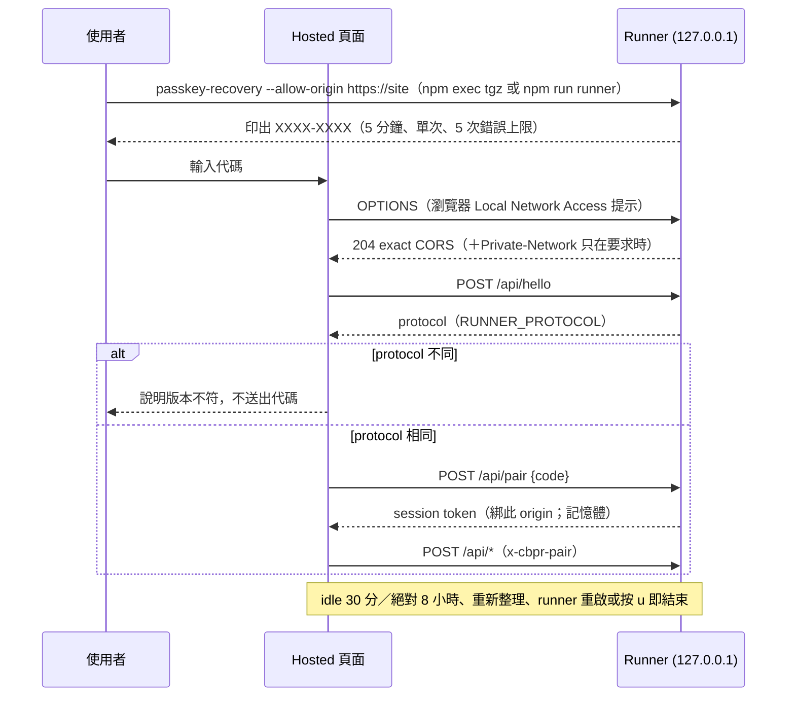

# Hosted／Local 統一產品：本機 runner、配對、三種 gas 錢包

> **Doc class**: Lifecycle appendix（current authority，2026-11-01）。上層：[`2-tech-spec.md`](./2-tech-spec.md) §8、[`3-architecture.md`](./3-architecture.md) §9。決策：[ADR-003](./adr-003-local-runner-pairing.md)（runner＋配對）、[ADR-004](./adr-004-bookmarklet.md)（bookmarklet）。AC 與證據：`requests/2026-11-01-unified-hosted-local-gas-wallets.md`（私人紀錄，不公開）。

## 1. 部署形態

> **2026-11-02**：runner 預設 port 為 **4171**（signer 4172）；`npm run preview` 是完整本機預覽（build 後以 runner 4171 啟動），只服務靜態檔的 Vite preview 是 `preview:static`（4181）；本機 HTTP 靜態預覽不顯示必然被拒的 `--allow-origin http://…` 指令；頁面依能力與 protocol 區分 runner 頁、HTTPS 官網、靜態預覽、已配對、版本不同與離線（`pageKind`）。完整對照見 [`6-recovery-atlas.md`](./6-recovery-atlas.md) §6。

同一份 `src/`、同一份 UI；差別只在 API 從哪裡來。

| 形態 | 如何取得 | UI origin | API | 模擬 | 送出 |
|------|---------|-----------|-----|------|------|
| Local（fallback，建議） | clone 公開 repo 後 `npm run runner`（`dist-server/runner.mjs`），或 `npm exec --yes --package ./passkey-recovery-<version>.tgz -- passkey-recovery`（目前是自己 `npm pack` 做出的 tgz；Release 尚未發布，也沒上 npm registry） | `http://127.0.0.1:4171` | 同 origin；頁面 meta 內的 session token（`x-cbpr-session`） | runner 內的釘選 Anvil fork | 三種 gas 錢包皆可 |
| Hosted | `npm run build:hosted` → `dist-hosted/`（靜態＋`_headers`）；**尚未部署** | 官方 https 網站 | 沒有自己的 API；使用者配對本機 runner 後經 `http://127.0.0.1:<port>`（`x-cbpr-pair`） | 只在配對後、由本機 runner 執行；**沒有雲端模擬** | 瀏覽器錢包與瀏覽器 File；native 模式需要 runner 的 signer |
| 舊 sidecar | `npm start`（4173） | `http://127.0.0.1:4173` | 同 origin | 使用者 `PATH` 上的 anvil | 瀏覽器錢包、瀏覽器 File、Terminal signer hand-off |

```
┌ browser tab (local or hosted UI) ─────────────────────────────┐
│  Passkey assertion (extension / helper / bookmarklet)          │
│  gas payer: EIP-6963 wallet │ browser File key (memory only)   │
└──────┬───────────────────────────────┬────────────────────────┘
       │ /api/* (session or pair token) │ /gas/* (password, 1P link)
┌──────▼─────────── runner (127.0.0.1:4171) ┐  ┌─▼ signer child (:4172) ┐
│ keyless sidecar: read, plan, simulate,    │  │ holds ≤ 1 unlocked key  │
│ issue exact tx, validate relay, track     │◄─┤ signs only issued tx    │
│ Anvil fork (pinned, lazy, child process)  │IPC│ native File store, op  │
└──────┬────────────────────────────────────┘  └─────────────────────────┘
       │ JSON-RPC (allowlisted methods, SSRF guard)
   Plasma 9745 RPC
```

## 2. Runner

| 項目 | 規格 |
|------|------|
| 綁定 | `127.0.0.1` 兩個 port：UI／API（預設 4171）、native signer（預設 port＋1）；`--port`／`--signer-port` 1024–65535 |
| 子程序 | Anvil：`@foundry-rs/anvil-<platform>` 1.7.1（optional dependency，五個平台 sha256 釘選，mismatch 拒跑），只在 `/api/rpc/probe` 或 simulation 時啟動；signer child：`fork()`，IPC 通道 |
| 結束 | SIGINT／SIGTERM 只結束自己啟動的子程序（Anvil、signer），所有 session 失效；不刪 store。停止時切斷瀏覽器仍開著的連線（`closeAllConnections`），分頁開著也不會讓 runner 停不下來 |
| 不做 | 執行使用者提供的指令、對外暴露 raw Anvil RPC、綁 0.0.0.0、讀取 `CBPR_RPC_URL_FILE` 以外的 RPC secret |
| 版本協商 | `RUNNER_PROTOCOL = 1`；UI 拒絕不同 protocol 的 runner |
| Signer API | `SIGNER_API`（`src/config/signerApi.ts`，目前 2）：頁面依賴舊 signer 沒有的 endpoint 或欄位時遞增。signer 在 `/gas/status` 回 `api`，沒有這個欄位視為 1。`/gas/status` 不受 busy 阻擋（解鎖等待 1Password 時也回答），頁面因此總能讀到版本；頁面的狀態讀取有順序，較早發出、較晚回來的讀取不會蓋過較新的狀態，舊 signer 的 409 busy 不清除已知狀態。頁面在任何解鎖前比對（`signerCompat`）：還沒讀到時三種 native 模式停用（`gas.opt.waitRunner`），不同即停用並顯示更新指引（§7「Runner 版本不符」），不送出任何解鎖請求；不改走其他錢包、不略過驗證。signer 對未知 endpoint 的 404（不帶 `kind`）在頁面轉為 `runner-outdated`，同一份指引。簽署被拒時 signer 回穩定代碼（`SIGN_REFUSALS`：`sign-locked`、`sign-unconfirmed`、`keystore-changed`、`keystore-stale`、`keystore-key-changed`、`sign-other-wallet`、`sign-bad-tx`、`sign-failed`、`sign-stopped`、`sign-timeout`），sidecar 的部署與轉帳 relay 以 409 的 `kind` 轉給頁面（不認得的代碼一律 `sign-failed`），頁面顯示 `gas.err.<code>` 的 EN／繁中文案，不顯示 signer 的英文原因 |
| 靜態頁面 | sidecar 在**啟動時**把 `dist/` 讀進記憶體（`server/staticSnapshot.ts` `snapshotDist`：只收一般檔案、略過 symlink、總量上限 64 MiB；沒有 build 時每個頁面請求都 404）。之後 `npm run build` 改寫磁碟上的 `dist/`，執行中的 runner 仍提供啟動時那一版，頁面與同一個 runner 啟動的 sidecar、signer child process 一致（signer 是另一個 process，`server/runner/signerChild.ts`）；要用新 build 必須重新啟動（signer 一起重啟）。2026-11-01 的 `unknown endpoint` 就是舊做法（每次請求讀磁碟）讓新頁面配上記憶體中的舊 signer |
| 既有 gas 錢包 | `--gas-manifest <絕對路徑>`：public manifest 的位置（預設 `~/.local/share/passkey-recovery/gas-wallet-public.json`，與 Terminal signer 相同）。路徑只在 runner 啟動時決定，頁面送不了路徑 |
| 官方 origin | `OFFICIAL_ORIGINS` 目前為空（網站未部署）；使用者以 `--allow-origin https://…` 自行加入，exact match、無 wildcard、無 path |

## 3. 配對與本機 API 隔離



| 檢查 | 行為 |
|------|------|
| Host | 不是 `127.0.0.1:<port>` → 421（DNS rebinding） |
| Origin | 非 allowlist、缺少 → 403；跨 origin 帶本機頁面的 `x-cbpr-session` → 403 |
| Method／type | 只收 POST JSON（GET 405、非 JSON 415） |
| Session | 每個 origin 一個；重新配對取代舊 token；另一個 allowlisted origin 冒用 → 403 且不影響原 session |
| Body 上限 | 一般 32 KiB；relay `MAX_RELAY_BODY_BYTES` = 2 × 128 KiB＋4 KiB（raw tx 上限 `MAX_RAW_TX_BYTES` 128 KiB，對齊 geth txpool `txMaxSize`；部署步驟的 initcode ≤ 49,152 bytes） |
| Redaction | 錯誤不轉述 RPC 原文、`op` stderr；log 不含 token、代碼、地址全文 |
| 儲存 | 配對 token 與 session 只在分頁記憶體，不進 Web Storage／URL |
| 中斷配對 | 「中斷連線」先（以這個配對）請 signer `/gas/lock`（盡力而為；也結束它仍在等的 1Password 核准），再清除配對。頁面立即清除對那個 signer 的所有認知（狀態、地址、版本、選檔綁定、等待中的解鎖與錯誤）；之前發出、之後才回來的請求不留下結果或錯誤；重新配對後重新讀新 signer 的狀態 |

## 4. Gas 錢包（payer）

| 模式 | 金鑰位置 | 流程 | 生命週期 |
|------|---------|------|---------|
| `wallet` | 使用者的瀏覽器錢包 | EIP-6963 列出全部 provider（多個候選時不自動選，只有一個時直接用它；400 ms discovery 後才退回 `window.ethereum`）；名稱 `sanitizeName` 40 字純文字；只用 Plasma 9745 | provider、帳戶或 chain 變動 → 已簽 plan 作廢 |
| `browser-file` | 這個分頁的記憶體（`src/wallet/fileWallet.ts`） | 產生（密碼 ≥ 12 字，下載加密 v3 keystore，高風險警告）或開啟檔案 → 確認完整地址 → 頁面簽 sidecar 發出的 exact tx → sidecar 驗證後轉送 | 離開模式、lock 或關閉分頁即清除；lock 時進行中的 open／create 作廢（generation） |
| `native-file` | runner signer child | keystore 存 OS app-data（macOS `~/Library/Application Support/passkey-recovery/gas-wallets`；0700／0600；O_EXCL＋hard link 不覆寫；拒 symlink、repo、temp、cloud-sync） | 留在 signer child 記憶體，直到 `/gas/lock`（離開模式時 UI 會呼叫）、換一把 key 或 runner 結束；**關閉分頁本身不清除**。`/gas/lock` 不受 busy 阻擋，進行中的 unlock 回 409 `lockedMeanwhile` |
| `native-keystore`（既有 gas 錢包） | 使用者自己既有的加密 v3 keystore（不搬、不重新加密、不寫入 signer 的磁碟；manifest／路徑欄位由 signer 直接唯讀讀取，「選擇檔案」則由頁面經 loopback 把加密文字送到本機 signer，不上傳到網站或遠端，見 §4.1）；密碼在 1Password | 三種來源，manifest 只是其中一個（§4.1「使用者選的 keystore」）。**manifest**：「找到錢包」→ `/gas/manifest/status` 只回 manifest 的 address、chainId、keystore 路徑，並先檢查 keystore → 顯示完整地址 → 貼**存放 keystore 密碼的那個 item** 的 Private Link → 讀取欄位 → **選密碼欄位**（必選，和另外兩種來源一樣）→ `/gas/manifest/unlock`（`confirmAddress` 必須等於 signer 當下重新載入的 manifest 地址；不同或缺少即 `manifest-stale`，請使用者重新尋找並核對完整地址）→ signer 讀 keystore、`op item get` 取使用者選的欄位、在記憶體解密 → 推導出的地址必須等於 manifest 的；確認與每次簽署前再讀一次釘選的 keystore（不符即鎖定，`keystore-changed`）。**item 的路徑欄位**或**使用者選的檔案**：`/gas/keystore/unlock`，密碼取自使用者選的欄位，解鎖後未確認，顯示完整地址後另按「確認」 | 同 `native-file`；欄位值用完即清空；路徑來源在確認與每次簽署前重新讀檔比對 sha256；選檔來源由持有檔案的頁面重新讀取並回報 sha256（確認時一次、之後每 2 秒），**每次簽署**都要等一次在簽署請求之後讀的相符回報；不同或讀不到即鎖定（`keystore-changed`），8 秒內沒有回報就拒絕簽署 |
| `native-op` | runner signer child | 貼 1Password Private Link → `op item get <item> --vault --account --format json`（structured argv、無 shell、512 KiB、timeout；env 見 §4.1）→ 由使用者的 1Password 桌面 App 核准 → 只回欄位 metadata＋shape → 選欄位 → unlock 只回地址 | 同 `native-file`；stdout buffer 解析後歸零；`/gas/lock`（含離開模式、「停止等待」）也會結束仍在等核准的 `op`，該請求回 `op-cancelled`，事後在 App 核准也讀不到任何東西 |

### 4.1 1Password：桌面 App 整合

`op` 只透過官方的 [1Password 桌面 App 整合](https://www.1password.dev/cli/app-integration)登入：使用者在自己的 1Password App 以 Touch ID 或密碼核准。1Password 的登入憑證（token、session、主密碼）從不交給網頁或 runner；所選欄位的 gas 私鑰只進入隔離的 signer 子程序記憶體（§5），網頁、sidecar 與 runner 主程序都不接收它。

| 項目 | 規則 |
|------|------|
| 子程序 env（`opChildEnv`） | 只有 `PATH`、`HOME`、`XDG_CONFIG_HOME`，加上固定的 `OP_BIOMETRIC_UNLOCK_ENABLED=true`（官方整合開關，非秘密）。呼叫端的 `OP_SERVICE_ACCOUNT_TOKEN`、`OP_SESSION_*`、`OP_CONNECT_*`、`OP_ACCOUNT`、`OP_CONFIG_DIR`、proxy、`NODE_*`，以及呼叫端自己的同名開關（例如 `false`），一律不傳。不接受 service account、session token 或 Connect 作為 fallback |
| 啟動環境 | 從哪個 Terminal 啟動 runner（`npm run runner` 或自己打包的 tgz）都可以；env 不影響認證。macOS 會依「啟動 runner 的 App」（Terminal、iTerm、編輯器內建 terminal）決定能否讀取 1Password 的資料 |
| 使用者設定（本人操作） | ① 1Password App：Settings > Developer > 開啟「Integrate with 1Password CLI」，App 保持執行（menu bar）。② macOS 27：系統設定 > 隱私權與安全性 > 檔案與資料夾 > 啟動 runner 的 App > 開啟「Data shared by 1Password…」。③ 該帳號已加入 1Password App |
| `op whoami` | 不會觸發核准，因此不能拿來驗證整合是否可用；要用實際讀取（runner 只執行 `item get`） |

**Private Link 與帳號 ID 的大小寫**：Private Link 的 `a=` 是帳號 ID（26 個大寫英數字），`v=`／`i=` 是 vault／item ID（26 個小寫英數字）。op 2.39 的 `--account` 以帳號 shorthand、sign-in address、account ID 或 user ID 篩選，**account ID 區分大小寫**：小寫化的 ID 會得到 `found no accounts for filter`。所以 `parsePrivateLink` 原樣保留 `a`／`v`／`i`，只把 host 轉小寫（DNS 名稱）；大小寫被改過的連結以 `op-link` 拒絕（「請重新複製 Private Link，原樣貼上」），不猜測、不改寫。`--account` 永遠是連結的帳號 ID，不用 host：同一個 sign-in address 下可能有多個帳號，用 host 篩選會得到 `found multiple accounts for filter`。

**既有 gas 錢包（`native-keystore`）的檢查**（`server/runner/gasManifest.ts`）：

| 檢查 | 失敗時（`gas.err.manifest-*`） |
|------|-------------------------------|
| manifest：一般檔案、非 symlink、≤ 16 KiB、JSON 物件；`address`、`chainId` 等於 9745、`keystore` 是絕對路徑、`keystoreSha256` 64 hex、`passwordReference` 是 `op://<vault id>/<item id>/password`（`OP_REF_RE`） | `missing`／`malformed`／`chain` |
| keystore：一般檔案、非 symlink（`O_NOFOLLOW`）、只有擁有者有權限（非 Windows 平台拒絕 group／other 權限，建議 0600；Windows 不做 POSIX mode 檢查）、≤ 64 KiB、sha256 等於 manifest 釘選的值 | `keystore`／`changed` |
| Private Link 的 vault 與 item 等於 `passwordReference` 的（帳號取自連結本身） | `link` |
| 使用者選了密碼欄位，且 item 裡有這個 field id、值不是空的（只比 field id，不用 label 猜，不會改用其他欄位）；所選欄位的值只作為 keystore 密碼，**不解析成 raw private key**，也不改選其他欄位 | `password-field`（選錯欄位：`wrong-password`） |
| keystore MAC 不符 | `wrong-password` |
| 推導出的地址等於 manifest 的 `address` | `address` |
| 頁面送出的 `confirmAddress` 等於 unlock 當下重新載入的 manifest 地址（例如「尋找」之後 manifest 換成另一個錢包） | `stale` |

**使用者選的 keystore**（`/gas/keystore/unlock`，`server/runner/keystoreSource.ts`；AC 見 `requests/2026-11-01-keystore-source-choice.md`（私人紀錄，不公開））：manifest 可以不存在，也不必手動編輯。使用者貼 item 的 Private Link、讀取欄位，再選 keystore 的來源與**密碼欄位**（必選、不能和路徑欄位相同；不會自動改用名為 password 的欄位）：

| 來源 | 頁面送出 | signer 做的事 |
|------|---------|--------------|
| item 的路徑欄位 | 只有欄位 id（`source: {kind:'field', field}`），**從不送路徑** | `op item get` 後讀該欄位的值當路徑（欄位名稱與 shape `file-path` 只是提示），通過下表檢查後唯讀讀取 |
| 使用者選的檔案 | 檔名（只顯示用：去掉 `/`、`\`、控制字元，≤ 120 字）＋加密 keystore 文字，只送往 runner 的 signer（hosted 時是配對的本機 runner；靜態網站沒有 API） | 先驗證（≤ 16 KiB、v3 格式）才執行 `op`；不寫入磁碟、不留副本。頁面只知道檔名，顯示「頁面無法得知這個檔案在你電腦上的位置」。signer 沒有路徑可重讀，所以由頁面（app 層的 `useGasPayer`，gas sheet 關閉後仍執行）重新讀取同一個 `File`：`/gas/confirm` 必須帶當下的 sha256，解鎖期間每 2 秒 `/gas/keystore/recheck`（只比對 hash，不受 busy 阻擋）；不符或讀不到（`''`）即清除 key。`sign()` 每次都換一個新的 challenge，等頁面帶著它回報相符的 sha256（`PICKED_SIGN_WAIT_MS` 8 秒，在 runner 15 秒 IPC 上限內；頁面看到 `pending` 會立即再讀），沒等到就拒絕但不清除（頁面關閉後就無法再簽）；等待中 key 換了或被鎖也拒絕。每次解鎖有自己的 `keyId`，confirm／recheck 必須帶它，屬於較早解鎖的回覆一律 409 且不改動目前的 key。選的 `File` 綁定到這個分頁解鎖得到的 `keyId`：同一個 runner 的其他分頁只看得到共享狀態，不會回報、也不能確認（顯示 `keystore-other-tab`，不送任何請求）；較早一次解鎖的回覆若在換模式或新的解鎖之後才到，也不會重新綁定。背景 recheck 發現變更時，原因保留在頁面狀態：gas chip 顯示「已鎖定，點開查看原因」，sheet 顯示 `keystore-changed` 說明，直到再次解鎖。較早選的檔案晚讀完時不會覆蓋較新的選擇（generation） |

| 檢查 | 失敗時（`gas.err.keystore-*`） |
|------|-------------------------------|
| 欄位值去除前後空白後是**一個**絕對、已正規化的路徑（沒有 `..`、`//`、結尾 `/`、控制字元，≤ 1024 字）；`~`、相對路徑、`file://` 都拒絕 | `path` |
| `realpath` 必須等於路徑本身（路徑上任何一層 symlink 都拒絕） | `symlink` |
| 檔案不存在 | `missing` |
| `lstat`：一般檔案（目錄、FIFO、裝置都拒絕）；以唯讀 read stream（`O_RDONLY｜O_NOFOLLOW｜O_NONBLOCK`，不會卡在 FIFO；source scan 仍只允許 `store.ts` 使用寫入 API）開啟後，**對實際讀取的 descriptor** 再做一次 `fstat` 的全部檢查，且 inode／device 必須是先前檢查的那個 | `not-file` |
| 擁有者是 runner 的使用者，沒有 group／other 權限（建議 0600；Windows 不做 POSIX 檢查） | `permissions` |
| ≤ 16 KiB（`lstat` 與 descriptor 各檢查一次；最多只讀 16 KiB＋1 byte） | `size` |
| 讀取的位元組數等於 descriptor 的大小；讀取後路徑仍指向同一個 inode／device，大小與 mtime 未變（讀取中被修改或換掉即拒絕） | `not-file` |
| v3 keystore 結構（`version` 3、`crypto.kdf`、`crypto.ciphertext`）；錯誤訊息不含檔案內容 | `format` |
| 密碼欄位必選且不同於路徑欄位；選的欄位已不在 item 裡 | `password-field`（路徑欄位不在：`path`） |
| keystore MAC 不符 | `wrong-password` |
| 路徑等於 manifest 指定的 keystore，但 sha256 不等於釘選值 | `manifest-changed` |
| sha256 等於 manifest 釘選值，但推導地址不是 manifest 的 `address` | `manifest-address` |
| 確認或簽署時，路徑來源的檔案 sha256 和解鎖時不同（被改、被換、被刪）；選檔來源在確認或 recheck 時回報的 sha256 不同或是空的 | `changed`（409；key 立即清除；錯誤在回到的表單上仍會顯示） |

解鎖後的 status 只回公開資料：`origin`（`field`／`file`）、路徑欄位 id 與 signer 讀到的路徑（或檔名）、密碼欄位 id、keystore sha256、`manifest`（是否等於 manifest 的釘選值）；從不回密碼或 keystore 內容。來源、連結、欄位或檔案在頁面上變更就重設選擇；lock、取消、遲到的回覆（lock 後才回來的 `op`）都不安裝 key；改用另一個來源解鎖會取代並使原本的確認失效。這些都只影響 signer 的 key，不影響 sidecar 的 pending tracking。

錯誤分類（`classifyOpFailure`，依 op 2.39 實際訊息；stderr 只用來分類，從不轉給頁面）：

| kind | op 的訊息（節錄） | 頁面說明（`gas.err.op-*`） |
|------|------------------|---------------------------|
| `unavailable` | `No accounts configured for use with 1Password CLI`、`connecting to desktop app …`、`LostConnectionToApp`、`connection reset` | 開啟 CLI 整合、App 保持執行；macOS 允許「Data shared by 1Password」 |
| `locked` | `1Password app is locked`、`not currently signed in`、`session expired` | 解鎖 App 後再試 |
| （等待中） | — | `gas-op-waiting`：請在 App 核准；「停止等待」＝`/gas/lock` |
| `cancelled` | `authorization prompt dismissed`、`cancel`；或使用者按「停止等待」／離開模式：請求還在上傳時不啟動 `op`；`op` 正在等核准時結束它；inspect 在 `op` 剛回答後才被 lock 時不回傳已讀到的欄位。unlock 在讀取後（例如 keystore 解密中）才被 lock 時回一般 409（`lockedMeanwhile`，沒有 `op-*` kind），key 同樣不安裝 | 已取消、未讀取，可重試 |
| `denied` | `permission`、`not authorized`、`can't perform this action` | 1Password 拒絕，確認帳號可開啟該項目 |
| `timeout` | `op` 的 `authorization timeout`（App 的核准沒有被回應），或 runner 自己的時限到（預設 120 s），`op` 被結束 | 未讀取，重試並在 App 核准 |
| `account` | `found no accounts for filter`、`found multiple accounts for filter`、`multiple accounts signed in` | 連結的帳號不在這台電腦的 App 中 |
| `link` | （`op` 不執行） | 不是 Private Link，或 ID 的大小寫被改過（請原樣貼上） |

**欄位驗證**（`keyFromField`）：不依 inspect 階段的 shape 提示或欄位 label／type 預先拒絕；unlock 時 `readItem` 重新讀取欄位、依當下的內容重新分類，再嚴格驗證：

| 重新讀取的值 | 結果（HTTP，kind） | 頁面說明 |
|-------------|-------------------|---------|
| 整個值（去除前後空白）是 64 hex，可含 `0x`，且在 secp256k1 範圍內 | 解鎖；有 `confirmAddress` 時推導地址必須相同 | — |
| v3 keystore JSON，且另選了密碼欄位、MAC 相符 | 解鎖，顯示完整地址後另按「確認」 | — |
| v3 keystore，但沒選密碼欄位（或選的就是 keystore 本身那個欄位） | 400 `op-field-password` | 再選存放這個 keystore 密碼的欄位 |
| v3 keystore＋密碼欄位，但 MAC 不符（密碼欄位的值是空的也一樣交給解密判斷；密碼本來就是空的 keystore 會正常打開） | 400 `file-wrong-password` | 這個 keystore 的密碼錯誤 |
| 其他（空值、一般文字、地址、63／65 hex、中間有空白、兩把 key） | 400 `op-field` | 不是私鑰也不是 v3 keystore，沒有解鎖任何東西；請選存放 gas key 的欄位 |
| 是私鑰，但推導地址不是頁面顯示、使用者確認的那個（讀取後欄位被改過） | 409 `op-changed` | 請按「讀取項目欄位」重新讀取 |

不截斷、不補零、不猜測、不改用同一個 item 的其他欄位，也不會因此送出任何交易。

測試層級：unit（`op1p.test.ts`、`signerService.test.ts`，fake `op` 印出上表的 synthetic 訊息；env 汙染、取消、逾時）、e2e（`gas-payers.spec.ts` 的 desktop app integration test：unavailable 在 EN 與繁中各驗一次；dismissed、等待中與停止等待只驗 EN；連結保留後重試。這個 test 沒有跑 axe 或三種寬度，新狀態的繁中文案只由 unit 的 copy 檢查涵蓋）。帳號 ID 與多帳號：fake `op` 依 op 2.39 的規則篩選帳號（ID、user ID、shorthand 區分大小寫，sign-in address 不區分；0 筆或多筆各回 op 的訊息），unit 驗證同一個 host 上兩個帳號時只讀連結的帳號。欄位選擇：unit 用類似真實 item 的 synthetic item（`password` CONCEALED 存 raw key、`notesPlain`、`wallet_address`、空欄位）驗上面欄位驗證表的每一列，包含 metadata 過期（讀取後才改成 key、key 被換掉）；e2e 的 field choice test 驗所有選項都可選、提示不斷言「不是私鑰」、EN 與繁中的 `op-field` 錯誤，以及選 `password` 欄位後解鎖出正確地址。既有 gas 錢包：unit 用 synthetic keystore＋synthetic manifest 驗上表每一列，e2e 的 existing gas wallet test 驗完整地址、別的 item 的連結在 EN 與繁中都被拒、正確的連結解鎖同一個地址。使用者選的 keystore：`keystoreSource.test.ts` 驗路徑檢查（相對、`..`、symlink 與上層 symlink、0644／0640／0602、目錄、FIFO、超過 16 KiB、非 keystore 的錯誤不含內容、換檔後 sha256 改變、讀取不寫入，以及檢查後才換檔的回歸：換成另一個私有 keystore、換成 0644 再於開啟後換回、讀取中被修改、換成大檔時最多只讀 16 KiB＋1）；`signerService.test.ts` 用 synthetic keystore（realpath 的暫存路徑）＋fake `op` item（`keystore_path`、`password`、`notesPlain`）對兩種來源驗：解鎖未確認→確認→簽出的交易還原出的地址等於推導地址與 tx 的 `from`、錯誤密碼、只用所選的密碼欄位、等待核准時 lock、遲到的回覆、切換來源使確認失效、確認前後檔案被改／換／刪、manifest 釘選不符與地址不符、另一個 keystore 不受 manifest 限制、上傳檔在 `op` 前驗證、`/etc/hosts` 與非 keystore 檔不洩漏內容；選檔來源另驗：確認時沒有／不同／空的 sha256、確認後 recheck 不符、每次簽署都要等帶新 challenge 的回報（較早的相符檢查或舊 challenge 都不算）、回報顯示變更即清除、等待中 lock 再解鎖也不會用新 key 簽，以及屬於較早解鎖的 confirm／recheck 不改動目前的 key；e2e 的 keystore chosen test 驗兩種來源都先顯示完整地址再確認、EN 與繁中錯誤、頁面不送路徑、keystore 內容只送往 signer，第二個 test 驗確認前檔案被改時錯誤仍顯示、較早選的檔案晚讀完不覆蓋新選擇、確認後檔案被改時 chip 與 sheet 都顯示原因；第三個 test 驗另一個沒有檔案的分頁既不會鎖定、也不能確認第一個分頁開啟的 key，第四個 test 驗較早解鎖的晚到回覆不會搶走較新解鎖的檔案。guard mutation 都被擋下（清單見 handoff）。真人證據：使用者在 Terminal 核准過一次 `op vault list`（2026-11-01，PM 紀錄，未讀任何 item）；較早一次經 runner 讀 item metadata 的嘗試停在等待核准逾時；帳號 ID 修正後，PM 在真實 UI 經 runner **成功讀出真實 item 的欄位 metadata**（2026-11-01，PM 紀錄；即 `requests/2026-11-01-op-field-choice.md`（私人紀錄，不公開） 的來源）。**本次欄位選擇修正後的真人選欄位、解鎖與完整地址核對、真實 keystore＋1Password 模式、真實提款都尚未驗證**。**2026-11-02 更新**：PM 以真實的「既有 gas 錢包（keystore＋1Password）」模式完成一筆 1 USDT0 mainnet 轉帳並自行核對（PM 紀錄，不公開 tx、地址或區塊）；這只證明這一個模式的這一條流程，其他 gas 模式的真人 mainnet 提款仍未驗證。

**Intent binding**：sidecar 先 issue 一筆 exact tx（`/api/deploy/issue`、`/api/transfer/send-request`），payer 只簽那筆；relay 時解碼欄位並 recover 簽署者，任何不同即拒絕，且在任何網路呼叫之前。Payer 或 RPC 變動 → `voidAll()`，正在簽署中的 issue 也作廢，簽完回來的 send 得到 409、什麼都不送（`server/deployRelay.ts`）。

## 5. Secret 邊界（HOST-03）

| 資料 | 可以在 | 永不在 |
|------|--------|--------|
| Gas 私鑰、keystore 密碼 | 瀏覽器 File：該分頁的 JavaScript 記憶體（runner 頁面或 hosted 網站皆可，兩個 origin 都只留在本機瀏覽器）；native 模式：runner signer child 記憶體（native File 的密碼在頁面輸入，送出前短暫存在頁面的 React state，只送往 signer） | sidecar、hosted 網站的任何**伺服器端點**（靜態網站本來就沒有 API，也從不送出）、Web Storage、log、report、argv、URL、chat |
| 1Password 欄位值（密碼、私鑰、keystore 內容） | signer child 記憶體 | 同上；UI 只看到 label／type／shape。例外：使用者選為 keystore 路徑的欄位，其通過 §4.1 檢查的路徑屬於公開來源資訊，和欄位 id、keystore sha256 一起回到本機（或配對的 hosted）頁面供確認（§4.1 status） |
| Passkey assertion、signature、signed UserOp | 當次請求記憶體 | log、URL、storage、git |
| 配對 token | 分頁記憶體、runner 記憶體 | storage、URL、log |

## 6. 威脅模型（新增面）

| 威脅 | 緩解 | 證據 |
|------|------|------|
| 任意網站呼叫本機 runner | exact origin allowlist＋一次性代碼＋Host 檢查＋瀏覽器 LNA 提示 | `pairing.test.ts`、`http-pairing.test.ts`、`s5c-lna-real-origin.json` |
| DNS rebinding | Host 必須是 `127.0.0.1:<port>` | `http-pairing.test.ts`「a bad Host → 421」 |
| 暴力猜代碼 | 30 字母表 8 碼、5 分鐘、5 次錯誤即作廢 | `pairing.test.ts` |
| 竊取 session | token 綁 origin、不落地、idle／絕對期限 | `pairing.test.ts`、e2e hosted |
| 惡意 EIP-6963 provider | 多個候選時不自動選、名稱純文字、未選者 0 次呼叫、晚到回應丟棄 | e2e GAS-02 |
| 重新 build 後新頁面配上執行中的舊 signer | 靜態頁面啟動時快照；`SIGNER_API` 比對；未知 endpoint 404 → `runner-outdated` 指引；都在解鎖前，不送密碼或連結 | `staticSnapshot.test.ts`、`signer-compat.test.ts`、`gas-runtime-ux.spec.ts` |
| 簽署中切換 payer／RPC 導致舊授權送出 | `voidAll` 涵蓋 busy issue；send 前重新檢查 | `deployRelay.test.ts` regression |
| 舊 unlock 在 lock 後復活 | generation counter（瀏覽器與 signer） | `fileWallet.test.ts`、`signerService.test.ts` regression |
| `op` 參數注入 | structured argv、無 shell、不接受使用者 flag | `op1p.test.ts`「argv metacharacters reach op as literal arguments」 |
| 呼叫端 env 切換 `op` 的認證方式（service account、session、Connect）或關掉桌面整合 | §4.1 `opChildEnv`：固定白名單＋固定開關 | `op1p.test.ts`「passes only PATH, HOME, XDG_CONFIG_HOME and the fixed desktop-app switch」 |
| 取消後 `op` 仍在背景等待，之後核准就讀取 | `/gas/lock` 結束所有等待中的 `op` 並立即回 `op-cancelled` | `signerService.test.ts`「a lock … while an unlock waits on the 1Password approval」 |
| 被替換的 Anvil binary | sha256 釘選；override 只在開發（標示 unpinned） | `anvil.test.ts` |
| keystore 寫進同步資料夾或 repo | store 位置規則 | `store.test.ts` |
| 書籤程式被改 | 固定 sha256、輸入只有資料 CODE、只認 `keys.coinbase.com` | `bookmarklet.test.ts`、ADR-004 |
| Hosted CSP 放寬 | 只多 `connect-src http://127.0.0.1:*`；`style-src 'self'`、無 inline script | `hosted-headers.test.ts` |
| SSRF | 原 guard 不變（198.18.0.0/15 等仍禁止） | `test/unit/net/guard.test.ts` |

## 7. UX（沿用 [`design-ui-ux-guidelines.md`](./design-ui-ux-guidelines.md) 的 Logbook 規則）

| 介面 | 規則 | 實作（testId／copy key） |
|------|------|-------------------------|
| 頂列 chip | 沒有 gas 錢包時顯示「No browser wallet」chip，點開 gas sheet；tooltip 列出所有 payer 選項（`wallet.noneHelp`） | `wallet-none`、`gas-chip`（`data-account` 為完整地址） |
| Gas sheet | 開頭說明 gas 錢包只付手續費、從不持有救回的資金（`gas.lead`）。版面（`logbook.css`「Gas sheet」段）：≥ 900px 兩欄（左：支付方式；右：只有選中方式的表單，`gas-form`，寬度上限 40rem），較窄時單欄。五個支付方式、既有 keystore 的三個來源、EIP-6963 錢包都是整列可點的選項列（`OptionRow`：radio＋短標題＋一句用途；`data-state` chosen／idle／off，選中另有「Chosen／已選」字樣與粗外框，不只靠顏色；`:focus-visible` 外框）。需要 runner 的選項沒有 runner 或 signer 版本不符時仍列出但停用，並在列內寫原因（`gas.opt.needsRunner`／`updateRunner`）；EIP-6963 錢包多個時不預選（只有一個時直接用它）。頂列 chip 用短標題（`gas.opt.<mode>`） | `sheet-gas`、`gas-mode-*`、`gas-form`、`wallet-pick` |
| Runner 版本不符 | signer 比頁面舊（`runner-older`）或新（`runner-newer`）：sheet 顯示 `gas-compat`（左側 flare 邊線），本機頁面說「在 runner 的 Terminal 按 Ctrl+C 再重新啟動（source checkout：`npm run build` 後 `npm run runner`；套件檔：用新套件重跑同一個 `npm exec … passkey-recovery`）、重新整理」——不寫 `npm start`，它啟動的是沒有 native signer 的舊 sidecar；`runner-newer` 在本機也要求停止 runner、source checkout 先 `npm run build` 再 `npm run runner`（套件檔則從同一個新套件啟動），因為 runner 只提供啟動時的頁面快照，只重新啟動會再提供同一個舊頁面，hosted 的 `runner-older` 說「更新 runner 後重新配對」，`runner-newer` 說「重新整理網站取得目前版本並重新配對；仍不符就改用與網站相符的 runner 版本」；寫明沒有解鎖任何東西；「再檢查一次」重新讀 `/gas/status`，相符即恢復，不需重新整理。解鎖時才遇到的 404 顯示 `gas.err.runner-outdated`，不要求使用者改欄位或密碼 | `gas-compat`（`data-compat`）、`gas-compat-recheck`、`gas.compat.*`、`gas.err.runner-outdated` |
| 地址確認 | 解鎖後顯示完整推導地址，按「確認」才可簽（確認後 sheet 關閉）；部署預覽與不可逆確認都再顯示一次完整付款地址，標示為「Gas wallet (pays the fee)」，和部署目標分開 | `gas-confirm`、`deploy-payer`、`deploy-confirm-payer` |
| File 產生 | 兩次輸入密碼（≥ 12 字）；下載加密 keystore；高風險說明（遺失檔案或密碼即無法取回）；確認前說明用途並可再下載（綁定它加密的地址：鎖定或開啟另一個 keystore 後不再提供） | `gas-file-new-password`、`gas-file-repeat`、`gas-file-why`、`gas-file-again` |
| 1Password | 貼 Private Link → 讀取欄位（只有 label／type／shape）→ 選欄位：**每個欄位都可以選**，不依 label、type 或 shape 停用（名為 password、type CONCEALED 的欄位也可能存放私鑰）；shape 只是提示（「看起來是私鑰」「未辨識為私鑰」），解鎖前不會斷言「不是私鑰」。解鎖時 signer 重新讀取該欄位的實際值並嚴格驗證（§4.1 欄位驗證），不符就拒絕。**private-key-hex 欄位**：讀取時已附推導地址，選單與 `gas-op-picked` 顯示「解鎖 0x…」完整地址；一次按「解鎖並使用這個 gas 錢包」送出 `confirmAddress`，signer 重新讀取後推導的地址不同即 409 `op-changed`、什麼都不解鎖，相同才解鎖並確認。**keystore-v3 欄位**：解鎖前無法得知地址，要再選密碼欄位，解鎖後顯示完整地址，另按「確認」。解鎖進行中連結與欄位停用（按下時確認的就是解鎖的那一個）。讀取／解鎖等待 App 核准時顯示 `gas-op-waiting`＋「停止等待」；各種失敗見 §4.1 | `gas-op-inspect`、`gas-op-waiting`、`gas-op-stop`、`gas-op-picked-address`、`gas-op-unlock`、`gas-op-password-field`、`gas-confirm` |
| 既有 gas 錢包 | 先選來源：manifest 的（有 manifest 時預設；貼連結 → 讀取欄位 → 選密碼欄位 → 使用）、item 的路徑欄位、自己選的檔案。解鎖等待中關閉再開 sheet，仍顯示等待與「停止等待」，來源不能更換；關閉期間才回來的解鎖或確認失敗，重新開啟時仍顯示原因（錯誤存在 payer 狀態，直到重試或新的解鎖）。後兩者：貼 Private Link → 讀取欄位 → 選路徑欄位（每個欄位都可選；提示只談路徑用途：「看起來是檔案路徑」或「不像檔案路徑，仍可選」，`gas.ks.pathShape.*`，不用私鑰 shape）或選檔案（只顯示檔名與大小，超過 16 KiB 在頁面就拒絕）→ 選密碼欄位（選單排除路徑欄位）→「開啟這個 keystore」→ 完整地址＋來源（讀取的路徑或檔名、sha256、是否為 manifest 釘選）→「確認」。流程以步驟清單呈現（`gas-ks-stages`：選 keystore → 讀 1Password 項目 → 選欄位 → 開啟 → 核對完整地址，各步 done／now／next／waiting／failed，目前步驟 `aria-current`；等待 App 核准與解鎖中標示 waiting，失敗標示 failed 並可重試）。sha256、manifest 等工程細節收在「Technical details／技術細節」展開區。檔案說明寫明只送往這台電腦的 runner signer（顯示其 origin）、不送網站、不留副本 | `gas-ks-stages`、`gas-ks-stage-*`、`gas-ks-from-manifest`／`-field`／`-file`、`gas-ks-item-link`、`gas-ks-inspect`、`gas-ks-path-field`、`gas-ks-pick`、`gas-ks-picked`、`gas-ks-password-field`、`gas-ks-open`、`gas-ks-source`、`gas-confirm` |
| Runner 停止回應 | sidecar 或 signer 任一呼叫的網路錯誤都算。hosted：該次呼叫的網路錯誤即結束配對（401 也是，但只結束該次請求所用的配對，舊配對遲到的 401 不影響新配對）（重新啟動的 runner 本來就會發新代碼），能力列回到「尚未連線＋連接 runner」，提示「用同一個指令重新啟動，按連接並輸入新代碼」：輸入的帳戶地址保留；重新配對是新的 session：sidecar 清除自訂 RPC，所以自訂 RPC 要重設；原本設了自訂 RPC 時清除會改變 RPC epoch：Check 重新開啟（帳戶地址保留）、尚未授權的 Move 草稿也要重新填寫（用預設 RPC 時 epoch 不變，兩者都保留）。runner 頁面：能力列改為「沒有回應」＋「再檢查一次」，原地重試、不重新整理，下一次有回應（sidecar 或 signer）即恢復；只有 runner 已重新啟動（sidecar 的同 origin 403 或 signer 的 401：session 不是它發的）才請使用者重新整理並說明會清除輸入 | `caps-lost`、`caps-retry`、`caps-reload`、`app-notice` |
| 配對 sheet（hosted） | 說明網站本身無法讀鏈、模擬或轉送（`pair.lead`）；三步：在已建置的 clone 執行的指令（`npm run runner -- --allow-origin <本站>`；Release 尚未發布，所以不用 tgz，另有連到 Download 步驟的連結）＋複製、等「Pairing code」、輸入代碼按 Connect（一次按下依序 hello 與 pair，協定不符即停）；預設 `127.0.0.1:4171`，其他 port 收在「runner 在其他 port」；預告瀏覽器的區域網路提示（`pair.lna`）；代碼 8 碼（大小寫與 `-` 皆可）、單次、5 分鐘；配對成功即關 sheet 並提示輸入的帳戶地址仍在 | `pair-command`、`pair-copy`、`pair-advanced`、`pair-submit`、`pair.*` |
| Bookmarklet | 可拖曳的書籤、複製書籤網址、複製 request code；顯示 sha256；複製被拒時提示手動選取 | `bm.*` |
| 本機有效期 | 沿用 M4-7：本機 plan 到期 ≠ 鏈上簽章撤銷 | `review-window` |

所有新狀態沿用 axe（WCAG 2.2 AA）、三個寬度無水平捲動、EN／繁中，由 `gas-payers.spec.ts` 與既有 `ui.spec.ts` 覆蓋。Gas sheet 版面另由 `gas-runtime-ux.spec.ts` 覆蓋：390／768／1440 × EN／繁中的選項列、鍵盤選擇與焦點外框、兩欄或單欄、步驟清單、長檔名、無水平溢位，1440 跑 axe；同一個 spec 也涵蓋 `gas-compat`（舊／新 signer 與恢復）及 hosted 配對下兩種來源。這個 spec 沒走到的狀態有以下例外。§4.1 的 1Password 桌面整合狀態（`gas-op-waiting`、`op-unavailable` 等），只有該節所列的 e2e 覆蓋，沒有 axe 或寬度檢查；既有 gas 錢包（`native-keystore`，`gas-ks-*`，含使用者選的 keystore）的錯誤與解鎖狀態只有 §4.1 所列的 e2e（完整地址、EN／繁中錯誤、解鎖），版面與選項列之外沒有 axe 或寬度檢查，`keystore-*` 中 e2e 沒觸發的錯誤文案只由 unit 的 copy 檢查涵蓋；1Password 欄位選擇與欄位驗證錯誤（`op-field`、`op-field-password`、`op-changed`）同樣只有 §4.1 所列的 field choice e2e（選項、提示、EN／繁中 `op-field`、解鎖地址），沒有 axe 或寬度檢查，`op-field-password`／`op-changed` 的文案只由 unit 的 copy 檢查涵蓋。

## 8. 測試專用環境變數

`CBPR_TEST_STORE_DIR`、`CBPR_TEST_OP_BIN`、`CBPR_TEST_KDF_N`、`CBPR_TEST_ALLOW_LOOPBACK_ORIGIN`（必須恰好 `1`）、`CBPR_TESTCHAIN_RPC`：只從環境讀、沒有對應 CLI flag（`runner.test.ts`）。說明見 request §3。

## 9. Release matrix

| 項目 | Local runner | Hosted | 狀態 |
|------|-------------|--------|------|
| Source build | `npm run build` | `npm run build:hosted` | ✅ 同一版本（`package.json`，目前 0.2.0） |
| 套件 | `npm pack` tgz，乾淨資料夾安裝執行 | — | ✅ 本機驗證；❌ 未 `npm publish` |
| 網站 | — | Cloudflare static assets＋`_headers` | ❌ 未部署（待 release 階段；`OFFICIAL_ORIGINS` 空） |
| Passkey：bookmarklet／DevTools helper | ✅ | ✅（同 UI） | virtual 層驗證；真實 OS Passkey 與書籤列點擊待使用者 |
| Passkey：extension bridge | ❌（`externally_connectable` 只有 `http://127.0.0.1:4173/*`，舊 sidecar） | ❌ | 沿用 ADR-002；要支援 runner／網站 origin 需改 manifest 並重做 S2 驗證（carryover） |
| Gas：wallet／browser File | ✅ | ✅ | synthetic 驗證 |
| Gas：native File／1Password | ✅ | 配對後 ✅ | fake `op`、synthetic key；PM 已在真實 UI 經 runner 讀出真實 item 的欄位 metadata；選欄位後的解鎖與地址核對未驗證（§4.1） |
| Gas：既有 keystore（manifest／item 路徑欄位／選檔） | ✅ | 配對後 ✅（keystore 只送往配對的本機 runner signer） | synthetic keystore＋fake `op`；2026-11-02 PM 以真實 keystore＋1Password 完成一筆 1 USDT0 mainnet 轉帳並核對（PM 紀錄，§4）；這張表其他來源與其他 gas 模式的真實 mainnet 流程仍未驗證（§4.1） |
| 模擬 | runner Anvil | 只經配對 runner | ✅ |
| LICENSE／SECURITY／CI、第三方授權追溯（EntryPoint GPL-3.0） | — | — | ✅ 檔案與 CI workflow 已建立（[`4-open-source-and-website.md`](./4-open-source-and-website.md) §3–§4）；公開 repo 的 CI 已通過（2026-11-07） |
| 發布前去個人化 | ✅ 原案例歷史已移到維護者私人文件，不在公開 allowlist；2026-11-02 決定不公開 case tx／地址（`4-open-source-and-website.md` §5.4） | — | ✅ 掃描 0 命中 |
