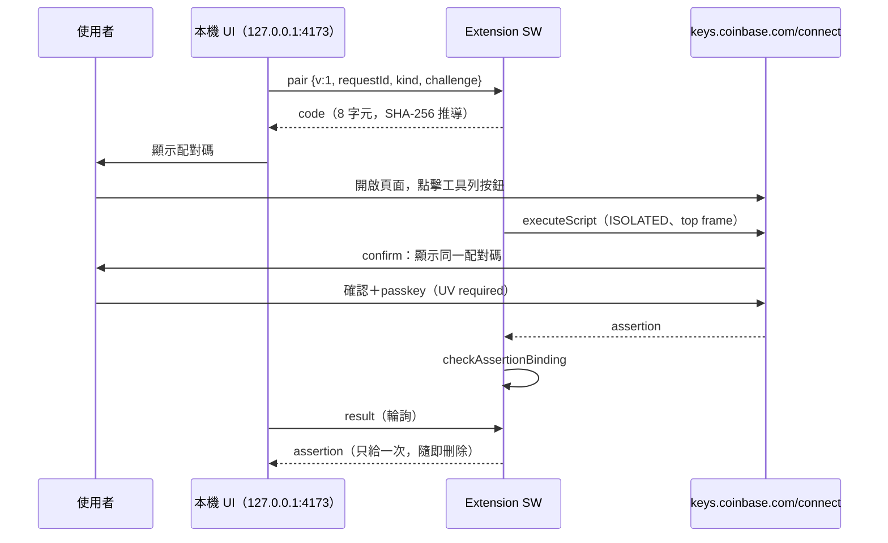

# ADR-002：以最小權限 MV3 extension 作為免 Console 簽署 bridge

> **Status**: Accepted for M2 preview（2026-10-31）—— 依據 virtual official-origin 層的 S2 go；**真實 OS passkey 層尚未驗證**，正式發佈前必須完成 [`checklist-m2-manual-verification.md`](./checklist-m2-manual-verification.md)。
> **Supersedes**: ADR-001 Decision 1 的「是否採用由 S2 決定」。**Evidence**: `requests/2026-10-31-m2-spike-results.md`（私人紀錄，不公開）

## Context

ADR-001 選出 extension 為主要候選；S2 在真實 `https://keys.coinbase.com/connect`（virtual authenticator、安全機制全開）證明：extension 注入的 `navigator.credentials.get` 以 keys.coinbase.com 為 origin、`crossOrigin=false`，且 challenge 完全由我們決定。S1 只能經剪貼簿回傳，S4 no-go。

## Decision

### 1. 權限（production `extension/manifest.json`）

| 項目 | 值 | 理由 |
|------|----|------|
| `permissions` | `activeTab`、`scripting`、`storage` | 只在使用者點擊時取得當前分頁一次性權限；`storage` 只用 `chrome.storage.session` |
| `host_permissions` | 無 | 不在背景讀任何網站 |
| `externally_connectable` | `http://127.0.0.1:4173/*` | 本機 UI 與 extension 唯一的通道 |
| 不採用 `nativeMessaging` | — | 需要安裝 native host（另一個可執行檔、更大的供應鏈面），而 UI 本身就在瀏覽器裡 |
| 不採用 loopback host permission（`http://127.0.0.1/*`） | — | 會讓 extension 能主動連本機任意 port；`externally_connectable` 方向相反（頁面找 extension），且 Chrome 只對列出的 origin 暴露 `chrome.runtime.sendMessage` |

固定 ID `imkijjdbgdekpebmpdjpgngpdambepok` 由 manifest 的 public `key` 決定（私鑰已丟棄；商店發佈時以商店簽章為準，需重新評估 ID）。

### 2. Protocol v1（`extension/protocol.js`、`src/bridge/client.ts`）

| 保護 | 實作 |
|------|------|
| Sender | exact origin＋URL origin＝`http://127.0.0.1:4173`、`frameId 0`（`senderAllowed`） |
| 請求形狀 | 嚴格 key set；`requestId` 32 hex；`kind` ∈ proof／userop；challenge 小寫 0x 32 bytes（`parseRequest`） |
| 注入位置 | 只在 `https://keys.coinbase.com/connect`（exact origin＋path）、`frameIds:[0]`、ISOLATED world（`isSignPage`） |
| 一次性配對 | 點擊時消耗 pending 並轉為 in-flight（簽署中 app 輪詢得 `waiting`）；同一配對不能簽兩次；新的 pair 取代舊的 pending／in-flight／結果；cancel、被取代或 in-flight 超過 3 分鐘時，簽完的結果直接丟棄（`extension/bridge.js`） |
| 併發 | 所有狀態的 read-modify-write 在同一把 lock 內（`createBridge`），兩個同時的 result 或點擊不會拿到同一份結果或配對 |
| 人工確認 | keys 頁的 `window.confirm` 顯示配對碼，使用者比對兩邊相同才繼續 |
| Challenge 綁定 | `checkAssertionBinding`：format、kind、rpId、`clientDataJSON` 的 type＝`webauthn.get`、origin、無 crossOrigin／topOrigin、challenge＝配對的那個 |
| 只在記憶體 | `chrome.storage.session`（不落碟、預設不對 content script 開放）；配對 5 分鐘、結果 2 分鐘後丟棄；結果取一次即刪 |
| 頁面端 | `chromeSend` 只在 origin＝4173 時存在；assertion 只回傳給呼叫者，不 log、不存、不進 URL；失敗時送 `cancel` |

簽章是否對 owner[0] 有效仍由 app 驗證（與貼上 assertion 相同路徑）；extension 不判斷錢包、不組 UserOp、不送交易。

### 3. 範圍

M2 交付：extension（preview）、bridge client、`ProofPanel` 內的 bridge UI（proof kind 走完全程）。**M3** 才把 `userop` kind 接到轉帳流程。Console helper 保留為進階手動流程。

## Threats

| 威脅 | 緩解 | 殘餘風險 |
|------|------|----------|
| 其他本機網頁冒充 app | `externally_connectable` 只列 4173；SW 再檢查 sender | 任何能在 127.0.0.1:4173 提供內容的本機程式都被視為 app（loopback 同機信任，與 sidecar 相同） |
| 使用者在錯的頁面點擊 | `isSignPage` 拒絕；配對保留 | — |
| 惡意頁面腳本竄改簽署函式 | ISOLATED world | keys.coinbase.com 本身被入侵時無法防護（與任何方式相同） |
| 對另一個 challenge 簽名（換包） | 配對碼人工比對＋binding 檢查 | 使用者不比對配對碼時，只剩 binding 檢查 |
| Extension 供應鏈 | 最小權限、可重現建置與 hash 公告（M5） | 更新通道；側載版本需使用者自行比對 |
| Assertion 外洩 | RAM only、一次性、TTL | 已取得的 UserOp 簽章在 nonce 被使用前都有效（**UI 的 10 分鐘是本機 plan 壽命，不是鏈上撤銷**） |

## Consequences

- 使用者不必開 DevTools；但需要安裝（側載或商店）extension，行動瀏覽器不支援。
- 固定 port 4173 成為 protocol 的一部分；改 port 必須同時改 `extension/manifest.json` 的 `externally_connectable`、`extension/protocol.js` 的 `APP_ORIGIN`、`src/bridge/client.ts` 的 `BRIDGE_APP_ORIGIN`，並讓 app 實際在新 port 提供（sidecar `CBPR_PORT`、`npm run preview` 的 `--port`）。
- 未驗證、不可宣稱：真實工具列點擊與真實 OS passkey（Touch ID／iCloud Keychain／security key）下的 user activation 與 UV；商店審核結果。
