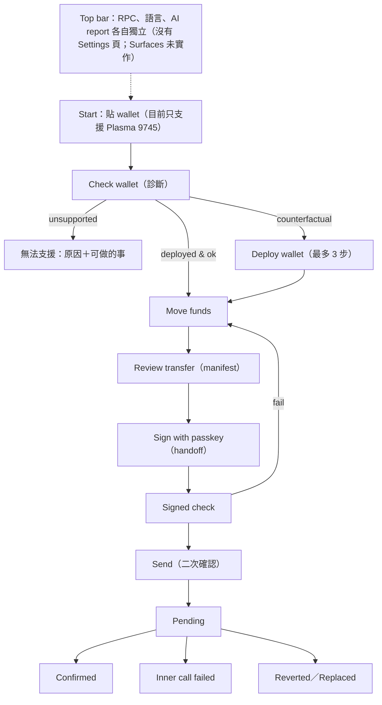

# Design & UX Guidelines — Passkey Recovery by sd0x

> **Doc class**: Ancillary — design guidelines（current authority for UI 規劃；Logbook UI 已依此實作於 `src/ui/`，與實作不同處以實作為準並在此註明）。
> 依據：`frontend-design` skill（official plugin 1.1.1）、Apple 公開資料（iOS 27 產品頁、support 149076「About iOS 27 Updates」、HIG Materials）。只參考公開的設計原則，**不複製** Apple 或 Coinbase 的商標、圖示或視覺識別。
> 所有 wireframe 的地址、金額、餘額、tx hash 都是 synthetic 範例，與原 case 無關。
> 上游：[2-tech-spec.md](./2-tech-spec.md) · [3-architecture.md](./3-architecture.md)
> **2026-11-01**：gas 錢包 sheet、地址確認、配對 sheet 與 bookmarklet 的介面規則見 [`5-hosted-local-runner.md`](./5-hosted-local-runner.md) §7；UX pass（步驟說明、能力標示、狀態、動畫、音效）見 §12。
> **2026-11-02**：網站改為 Chart & Course 方向、真實路徑路由與 receipt 語意修正，已實作，規則見 §13（原 §6.8 網站 wireframe 已由 §13 取代並刪除）。

## 1. 設計 brief

| 項目 | 內容 |
|------|------|
| Subject | 一個把卡在未部署 smart wallet 裡的資產「拉回岸上」的本機工具 |
| Audience | 熟悉加密錢包、但此刻焦慮的人；可能第一次接觸 ERC-4337 |
| Primary job | 讓使用者在**按下不可逆按鈕之前**，確定自己看到的就是將發生的事 |
| Tone | 冷靜、精確、不推銷；像一本航海日誌，而不是交易所 |

Subject 的語彙：救援、浮標、航海日誌（logbook）、艙單（manifest）、封蠟（seal）。視覺選擇從這裡來。

## 2. 參考：Liquid Glass 要拿什麼、不拿什麼

| 來自 Apple 公開資料（2026-10-31 讀取） | 我們的用法 |
|----------------------------------------|------------|
| Liquid Glass 是浮在內容層之上的「控制與導覽」功能層（HIG Materials） | 只用在 floating action bar、語言／設定 popover、top bar；**內容層（manifest、表格、說明）一律實心** |
| 「Don't use Liquid Glass in the content layer」「Use … sparingly」 | 每個畫面最多 2 個 glass 表面 |
| Regular variant 會模糊並調整亮度以維持可讀性；clear 只用在視覺豐富的背景上 | 只用 regular 類效果（`backdrop-filter: blur(20px) saturate(140%)` ＋ 62% 不透明底色）；不做 clear |
| iOS 27：更一致的折射與更好的對比；設定中有 ultra-clear 到 fully tinted 的滑桿（apple.com/os/ios、support 149076） | 提供「Surfaces: Glass／Tinted／Solid」設定，預設跟隨 OS 偏好 |
| HIG Materials：材質外觀會隨系統設定改變，例如使用者選擇的 Liquid Glass 外觀，或開啟降低透明度、增加對比的 accessibility 設定（2026-10-31 重新讀取原文；初次研究漏看，曾標記 UNKNOWN）。Apple 沒有規定網頁 CSS 該怎麼做 | 本工具自訂的 CSS 規則（不是 Apple 的規格）：`prefers-reduced-transparency: reduce` → Solid；`prefers-contrast: more` → Solid＋1.5px 邊框 |

## 3. 兩個版面方向與自評

### Direction A — Logbook（單欄日誌）

救援本來就是**有順序的**流程（診斷 → 部署 → 轉帳 → 追蹤），所以用一條垂直的 logbook：已完成的步驟收合成一行紀錄，目前步驟展開，未來步驟只顯示標題。桌面版右側固定一張 manifest（目前 intent 的 7 欄；費用欄分兩行：簽章綁定的 wallet fee 上限，與標示為估計值的 network fee），手機版 manifest 在確認前以 sheet 呈現。底部一條 glass action bar 只放「目前這一步的主要動作」。

```
Desktop ≥ 1024px
┌────────────────────────────────────────────────────────────────────┐
│ Passkey Recovery            Plasma 9745 ▾   RPC: public ▾   EN | 繁中 │  ← glass top bar
├───────────────────────────────────────────┬────────────────────────┤
│ ✓ Check wallet          0xA1b2…9F3c ok    │  Manifest              │
│ ✓ Deploy wallet         3 of 3 verified   │  Chain     Plasma 9745 │
│ ● Move funds                               │  From      0xA1b2 C3d4 │
│   ┌─────────────────────────────────────┐ │            …   9F3c    │
│   │ Asset    [ USDT0 ▾ ]                │ │  To        0x5B7e …    │
│   │ Amount   [ 250.00      ] of 4,120   │ │  Asset     USDT0       │
│   │ To       [ 0x…           ]          │ │  Amount    250.000000  │
│   │ To again [ 0x…           ]          │ │  Wallet fee ≤0.0004 XPL│
│   └─────────────────────────────────────┘ │  Network ≈0.0009 (est.)│
│ ○ Track                                    │  Nonce     2           │
├───────────────────────────────────────────┴────────────────────────┤
│                         [ Review transfer ]                         │  ← glass action bar
└────────────────────────────────────────────────────────────────────┘

Mobile ≤ 640px
┌──────────────────────────┐
│ Passkey Recovery   ⋯     │
├──────────────────────────┤
│ ✓ Check wallet           │
│ ✓ Deploy wallet          │
│ ● Move funds             │
│   Asset   [USDT0 ▾]      │
│   Amount  [250.00 ]      │
│   To      [0x…    ]      │
│   To again[0x…    ]      │
│ ○ Track                  │
├──────────────────────────┤
│ [ Review transfer ]      │
└──────────────────────────┘
```

### Direction B — Instrument panel（雙欄儀表板）

左側常駐「錢包狀態」側欄（餘額、owner、infra），右側工作區以分頁切換 Diagnose／Deploy／Transfer／Track；側欄是 glass。（未採用；wireframe 已移除，取捨見下表。）

### 自評

| 準則 | A Logbook | B Instrument panel |
|------|-----------|--------------------|
| 符合任務的順序性 | ✅ 順序就是版面；編號有意義 | ❌ 分頁讓使用者可以跳步，必須額外擋 |
| 確認時的專注度 | ✅ 一次只有一個主要動作 | ⚠️ 側欄資訊持續爭奪注意力 |
| 手機 | ✅ 自然退化成單欄 | ❌ 側欄要變 drawer，狀態被藏起來 |
| 是否落入生成式預設 | ✅ 避開 SaaS 卡片組 | ❌ 正是「相同圓角卡片＋側欄」的 SaaS kit |
| Glass 使用量 | 2 個（top bar、action bar），符合 HIG「sparingly」 | 側欄整片 glass，等於放進內容層 |
| 熟練使用者效率 | ⚠️ 需要捲動看已完成步驟 | ✅ 一眼看全部 |

**推薦 Direction A（Logbook）**。B 唯一的優勢（一眼看全部）由 A 的 manifest＋已完成步驟的一行摘要補足。修訂：初稿 A 的 manifest 原本也是 glass，自評時發現它屬於內容層，改為實心紙面。

## 4. Information Architecture



全域：top bar（chain、RPC 狀態與設定、語言、AI report），各自是獨立控制，沒有集中的 Settings 頁；網站導覽（Home、Guide、How it works、Security、Download、Recover）；footer（GitHub、非官方聲明）。

## 5. Design tokens

### 5.1 Color（6 個命名色）

| Token | Hex | 角色 | 規則 |
|-------|-----|------|------|
| `fog` | `#EEF2F3` | 畫布（冷灰藍，不是暖米色） | 背景 |
| `hull` | `#1D2A35` | 主要文字、圖示 | 在 fog 上對比約 13:1 |
| `chart` | `#3F5B73` | 次要文字、結構線、未來步驟 | 在 fog 上約 6:1 |
| `buoy` | `#C8410F` | 工具內**只**用於不可逆動作（Send、Deploy step）與「目前步驟」標記；唯一例外在網站頁（§13.2）：每頁一個主要 CTA（首頁「Check your wallet」，其他頁「Open the recovery tool」）與主圖上的「你在這裡」指標 | 白字約 5:1；一個畫面最多一個 buoy 按鈕 |
| `kelp` | `#2F7A5B` | 已驗證／confirmed | 白字約 5:1；在 fog 上約 4.6:1 |
| `flare` | `#B3261E` | 失敗、fail closed、inner-failed | 白字約 6.5:1；與 buoy 用形狀＋圖示區分，不只靠色相 |

Glass 表面：`rgba(238,242,243,0.62)` ＋ blur；Solid 模式為 `#FFFFFF` ＋ `chart` 1px 邊框。Dark mode（`prefers-color-scheme: dark`）：`fog`→`#121B22`、`hull`→`#E6ECEF`，其餘色相保持、亮度調整到同樣對比；**不用**純黑或 `#0B0B0B` 類近黑。對比數字是設計值，實作時以自動化工具驗證（NFR-4）。

### 5.2 Type

| 角色 | 字體 | 理由 |
|------|------|------|
| UI 與內文（拉丁） | **Atkinson Hyperlegible Next**（OFL，本機打包） | 為低視力讀者設計，`0/O`、`1/l/I` 明確區分 —— 正好是地址比對最怕的錯誤 |
| 地址、hash、金額值 | **Atkinson Hyperlegible Mono**（OFL，本機打包） | 只用在「值」本身，讓逐字比對對齊；**不**用在標籤 |
| 繁中 | 系統字：PingFang TC → Noto Sans TC（若已安裝）→ Microsoft JhengHei | 不從網路載入；避免打包大型 CJK 字型 |

Type scale（Elements of Typographic Style 的古典級數）：12／14／16（body）／18／21／24／36。Body line-height 1.5，繁中 1.7；行寬 ≤ 72 個拉丁字元（繁中 ≤ 36 字）。只用 400 與 700 兩個字重。標題 sentence case，**不使用 ALL CAPS 標籤、不在標題上方加 eyebrow**。

**Type 作為主動元素**：manifest 的金額以 36px Mono、完整小數位顯示，是整個介面最大的字 —— 使用者最該盯著看的就是它。

### 5.3 Spacing／radius／elevation／motion

| 類別 | Token |
|------|-------|
| Spacing（4px 基準） | 4、8、12、16、24、32、48 |
| Radius（依層級，不是一律相同） | 輸入框 6；manifest 紙面 2（像紙）；glass bar 20；sheet 頂部 16 |
| Elevation | 內容層無陰影；glass 層 `0 8px 24px rgba(29,42,53,0.14)`；modal 加 scrim `rgba(29,42,53,0.4)` |
| Motion | 預設 180ms ease-out 於狀態切換；工具內**唯一**的編排時刻是 manifest「seal」（Sign 成功時，manifest 邊框收合成封印、240ms）；工具以外的例外只在網站首頁（§13.2、[`6-recovery-atlas.md`](./6-recovery-atlas.md) §5）：主圖基準點環在進入首頁時畫一次（0.9 s），以及使用者按 Play 才開始、不循環的圖板序列（可暫停、重播，離開首頁或分頁隱藏即停）。其餘動態只回應狀態（§12）：步驟展開 6 px 位移、BusyLine 來回的條、Ladder 目前那一格的呼吸。`prefers-reduced-motion` → 全部停止 |

## 6. 畫面

### 6.1 Diagnosis（Check wallet）

```
┌ Check wallet ───────────────────────────────────────────┐
│ Network        Plasma (9745)                            │
│ Wallet         0xA1b2 C3d4 E5f6 … 7a8B 9F3c   [Paste]   │
│                                                         │
│ ✓ Chain matches            ✓ EntryPoint v0.6 found      │
│ ○ Wallet not deployed yet  ✓ Address matches owners     │
│ ✗ Factory missing          ✗ Implementation missing     │
│                                                         │
│ Balances at block 36,502,330                            │
│   XPL    3.402…    USDT0  shown after you choose        │
│                                                         │
│ What this means: your funds are at this address, but    │
│ the wallet contract isn't on Plasma yet. Deploy it next.│
└─────────────────────────────────────────────────────────┘
                    [ Continue to deploy ]
```

Unsupported 版本：標題「We can't help with this wallet yet」，列出觸發的原因碼（人話＋代碼），提供「Export report」與 GitHub issue 連結；**沒有**任何繼續按鈕。

### 6.2 Deploy

```
┌ Deploy wallet ─────────────────────────── 1 of 3 ───────┐
│ Step 1  Implementation contract                         │
│   To        Safe singleton factory 0x914d…43d7          │
│   Data      sha256 3f9c…a21e (pinned)                   │
│   Gas limit 4,822,375   Max fee 1 gwei                  │
│   Est. cost 0.00482 XPL; your wallet shows the final cap│
│   Simulated ✓ at block 36,502,330                       │
│ Step 2  Factory                         waiting         │
│ Step 3  Your wallet                     waiting         │
│                                                         │
│ Gas wallet  0x9c1E…44aD (connected)  balance 0.05 XPL   │
└─────────────────────────────────────────────────────────┘
                 [ Deploy step 1 in your wallet ]   ← buoy
```

### 6.3 Withdraw review（manifest）

```
┌ Review transfer ────────────────────────────────────────┐
│                       250.000000 USDT0                  │  ← 36px Mono
│ Network     Plasma (9745)                               │
│ From        0xA1b2 C3d4 E5f6 1234 5678                  │
│             90ab CDef 0011 7a8B 9F3c                    │
│ To          0x5B7e 0C11 9a3D 44f2 E810                  │
│             7c6B 2d95 aA01 3e7F c8D2  (typed twice ✓)   │
│ Token       USDT0 0xB8CE…5ebb                           │
│ Wallet nonce 2                                          │
│ Network fee  about 0.0009 XPL (estimate), gas wallet;   │
│              your wallet's confirmation shows the cap   │
│ Wallet fee   up to 0.0004 XPL from the wallet's         │
│              EntryPoint deposit; unused part stays there│
│              (deposit short by 0.0001 XPL: topped up    │
│              from the wallet's XPL balance first)       │
│ Checked     execution ✓  signature cost ✓  block 36.50M │
│                                                         │
│ ☐ I checked the To address against my own records       │
└─────────────────────────────────────────────────────────┘
                     [ Sign with passkey ]
```

### 6.4 Passkey handoff

依 ADR-001／ADR-004 有三種路徑；**bookmarklet 是主路徑**（免 extension、免 DevTools），extension 只在舊 sidecar（`127.0.0.1:4173`）頁面出現（`externally_connectable` 只有該 origin），DevTools helper 收在 Advanced：

```
┌ Sign with passkey ──────────────────────────────────────┐
│ 1. Copy the request code          [ Copy code ]         │
│ 2. Open keys.coinbase.com/connect in this browser       │
│ 3. Click your Passkey Recovery bookmark, paste the code │
│ 4. Approve with your passkey, paste the result below    │
│                                                         │
│ Bookmark SHA-256  5f579b12…6b6f  (check once)           │
│ Signs          the transfer above, nothing else         │
│ Expires        in 9:42                                  │
│                                                         │
│ Extension      only on the 127.0.0.1:4173 page;         │
│                elsewhere a one-line "not available" note│
│ ▸ Advanced: sign with the DevTools helper               │  ← 預設收合
└─────────────────────────────────────────────────────────┘
                [ Cancel ]   waiting for signature…
```

「Advanced」展開後顯示 DevTools Console 流程，頂部固定 flare 警示：「Only paste code you got from this app on this computer. Anyone asking you to paste code into a website is likely trying to steal from you.」並顯示程式 SHA-256。

### 6.5 Pending

```
┌ Sending ────────────────────────────────────────────────┐
│ 250.000000 USDT0 to 0x5B7e…                             │
│ Sent from your gas wallet  tx 0x7d2f…b310               │
│ Waiting for the network    0 confirmations              │
│ You can close this tab. We'll keep tracking when you    │
│ come back. We will never send it again.                 │
└─────────────────────────────────────────────────────────┘
```

### 6.6 Inner call failed

```
┌ Transfer didn't go through ─────────────────────────────┐  ← flare
│ The network accepted the transaction, but the wallet    │
│ call inside it failed. No USDT0 left your wallet.       │
│ The wallet nonce moved from 2 to 3.                     │
│ Network fee used: 0.00061 XPL.                          │
│ Next: start a new transfer. You'll sign again.          │
└─────────────────────────────────────────────────────────┘
                       [ Start a new transfer ]
```

### 6.7 Confirmed

```
┌ Transfer confirmed ─────────────────────────────────────┐  ← kelp
│ 250.000000 USDT0 arrived at 0x5B7e…                     │
│ Block 1,204,551   12 confirmations                     │
│ Evidence  receipt ✓  wallet call ✓  token transfer ✓    │
│ [ View on Plasmascan ]   [ Export receipt summary ]     │
└─────────────────────────────────────────────────────────┘
```

## 7. 狀態、錯誤與復原

| 狀態 | 文案方向 | 下一步 |
|------|----------|--------|
| RPC rate limited | 「The public RPC is busy. Retrying (2 of 3).」 | 3 次後：「Add your own RPC in Settings」 |
| Fork unavailable | 「We can't simulate on this RPC, so signing is off.」 | 改 RPC |
| Nonce changed | 「Something used this wallet since you reviewed. Review again.」 | 回 draft |
| Assertion invalid | 「That signature isn't for this transfer.」（顯示哪一項不符：origin／challenge／UV） | 重新簽署 |
| Wallet rejected | 「You cancelled in your wallet. Nothing was sent.」 | 保留 signed 狀態 |
| Reorg | 「The block holding your transfer was replaced. Tracking again.」 | 自動 |
| Outcome unknown（`outcome_unknown`） | 「We lost contact with your wallet while sending. The transfer may or may not have been sent, so this signature won't be sent again.」 | 「Paste the transaction hash from your wallet」或「Give up on this one」；兩者都保留追蹤 |
| Abandoned（`abandoned`） | 「You gave up on this transfer. We're still watching for it, in case it was sent.」開始新的前先檢查：舊的尚未執行 →「Your new transfer will use the same wallet nonce, so only one of the two can go through.」；舊的已成功 →「Your earlier transfer already went through.」 | 舊的已成功時不提供「重試」，只能明確選擇「Start a separate new transfer」；舊的列在 Track |
| Deploy step unknown（`step_unknown`） | 「We lost contact with your wallet during step {n}. Checking whether the contract exists.」 | 已存在 → 自動完成；不存在 → 「Plan step {n} again」（說明可能多付一次 gas） |
| Unknown code | 「This contract isn't one we've verified.」 | 停止、匯出 report |

錯誤不道歉、不模糊；一律說「發生什麼」＋「怎麼辦」。空狀態是邀請行動（「Paste a wallet address to start」）。

## 8. 財務確認元件

| 元件 | 規則 |
|------|------|
| `AmountDisplay` | 完整精度（USDT0 6 位、XPL 18 位，可收合顯示到 6 位但提供「Show exact」）；單位永遠緊跟數字；不做四捨五入 |
| `AddressDisplay` | 全文 checksum、4 字元分組、Mono；中段不以「…」取代（manifest 內）；其他地方縮寫為前 6＋後 4 並可展開 |
| `DualEntry` | recipient 輸入兩次；可以貼上，但任一欄是貼上的，都須勾選「已用獨立來源核對」才可 Review，任一欄再編輯就清除勾選（規則見 `2-tech-spec.md` M4 地址輸入）；不一致即時標示 |
| `FeeSplit` | 兩行：network fee（gas wallet 付 outer gas）與 wallet fee（UserOp 實際成本從 wallet 的 EntryPoint deposit 扣除、付給 beneficiary；未用完的 prefund 留在 deposit）；deposit 不足時另顯示一行「先從 wallet 餘額補足 N」，且 native 轉帳的可用上限要扣掉這筆補足額 |
| `IrreversibleButton` | buoy 色、文字是動作本身（「Send 250 USDT0」）；按下後開 confirm sheet；轉帳的 sheet 重述 7 欄，且必須輸入完全相同的金額才啟用確認鈕（`src/ui/primitives.tsx` 的 `IrreversibleButton`，`confirmWord` prop 由 `MoveStep` 傳入金額；按鈕開啟它自己的 `Sheet`）；部署步驟的 sheet 顯示較少欄位、不需輸入。1.5 秒 hold 與 Settings 切換**未實作** |
| `EvidenceRow` | receipt／wallet call／token transfer 三項分開打勾；任何一項未知就不顯示 confirmed |

## 9. Accessibility

| 面向 | 規則 |
|------|------|
| 鍵盤 | 全流程可 Tab；logbook 步驟為 `<ol>`；action bar 的主要按鈕在 DOM 中緊接目前步驟之後 |
| Focus | 2px `hull` 外框＋2px `fog` 間隔，glass 表面上也可見 |
| Screen reader | 狀態切換以 `aria-live="polite"`；失敗用 `assertive`；地址以 `aria-label` 逐組朗讀（「0x A1b2 C3d4 …」） |
| 對比 | WCAG 2.2 AA；不靠顏色傳達狀態（✓／○／✗＋文字） |
| Reduced transparency | glass → solid |
| Reduced motion | 所有 animation／transition（含 `::after`）為 0；狀態仍由文字表達 |
| 觸控 | 目標 ≥ 44×44 px |
| 語言 | `<html lang>` 隨切換；繁中不使用斜體 |

## 10. 雙語文案

| Key | English（預設） | 繁中 |
|-----|-----------------|------|
| `step.check` | Check wallet | 檢查錢包 |
| `step.deploy` | Deploy wallet | 部署錢包 |
| `step.move` | Move funds | 轉出資產 |
| `step.track` | Track | 追蹤 |
| `cta.review` | Review transfer | 檢查這筆轉帳 |
| `cta.sign` | Check Passkey proof | 檢查 Passkey 證明 |
| `cta.send` | Send {amount} {asset} | 送出 {amount} {asset} |
| `cta.deployStep` | Deploy step {n} in your wallet | 在你的錢包部署第 {n} 步 |
| `fee.network` | Network fee (estimate), paid by your gas wallet. Your wallet's confirmation shows the final cap. | 網路手續費（估計值），由你的 gas 錢包支付；最終上限以錢包確認畫面為準。 |
| `fee.wallet` | Wallet fee, paid from the wallet's EntryPoint deposit | 錢包手續費，從錢包的 EntryPoint 存款支付 |
| `pending.body` | You can close this tab. We'll keep tracking when you come back. We will never send it again. | 你可以關閉這個分頁。回來時會繼續追蹤，不會重新送出。 |
| `inner.title` | Transfer didn't go through | 轉帳沒有完成 |
| `confirmed.title` | Transfer confirmed | 轉帳已確認 |
| `unknown.title` | Not sure it was sent | 無法確定是否已送出 |
| `unknown.body` | We lost contact with your wallet while sending. This signature won't be sent again. | 送出途中與錢包失去連線。這個簽章不會再被送出。 |
| `unknown.paste` | Paste the transaction hash from your wallet | 貼上錢包裡的交易 hash |
| `unknown.abandon` | Give up on this one | 放棄這一筆 |
| `abandoned.body` | We're still watching for it, in case it was sent. | 我們會繼續追蹤，以防它其實已送出。 |
| `abandoned.sameNonce` | Your new transfer will use the same wallet nonce, so only one of the two can go through. | 新的轉帳會使用同一個錢包 nonce，所以兩筆之中最多只有一筆會成功。 |
| `abandoned.alreadyDone` | Your earlier transfer already went through. | 你先前的轉帳其實已經完成。 |
| `abandoned.separate` | Start a separate new transfer | 另開一筆獨立的新轉帳 |
| `deployUnknown.body` | We lost contact with your wallet during step {n}. Checking whether the contract exists. | 第 {n} 步進行中與錢包失去連線，正在確認合約是否已存在。 |
| `deployUnknown.replan` | Plan step {n} again | 重新規劃第 {n} 步 |
| `deployUnknown.cost` | If the earlier transaction also lands, you may pay gas twice for this step. | 如果先前那筆交易也上鏈，這一步可能會付兩次 gas。 |
| `warn.paste` | Only paste code you got from this app on this computer. | 只貼上這台電腦上本工具給你的程式碼。 |
| `footer.unofficial` | Not affiliated with Coinbase or Plasma. | 與 Coinbase、Plasma 無任何關係。 |
| `footer.credit` | Built by sd0x | 由 sd0x 製作 |

同一個動作從頭到尾同一個名字：按鈕「Send」→ 狀態「Sending」→ 結果「Sent／Transfer confirmed」。

## 11. 避免的預設（自我檢查清單）

- [ ] 沒有暖米色＋terracotta、近黑＋螢光色、報紙式 hairline 版面、相同圓角卡片＋灰陰影
- [ ] 沒有 ALL CAPS eyebrow、沒有以 middle dot 串接的 meta 字串、沒有「WORD — fragment」標籤
- [ ] Mono 只用在地址／hash／金額值，不用在標籤
- [ ] 連結與按鈕文字不加「→」
- [ ] 編號只出現在真的有順序的地方（logbook 步驟、部署 1 of 3）
- [ ] 工具內只有一個編排過的動畫（seal），網站只有首頁主圖的 0.9 s 基準點入場，加上訪客按 Play 才播、可暫停的圖板分鏡（[`6-recovery-atlas.md`](./6-recovery-atlas.md) §5）；其餘動態都在表達「正在進行」（§12），沒有裝飾性進場
- [ ] 每個畫面 glass ≤ 2、buoy 按鈕 ≤ 1（網站頁的 buoy 是那一頁唯一的主要 CTA）

## 12. UX pass（2026-11-01）

紀錄與量測：`requests/2026-11-01-ux-pass-hosted-local.md`（私人紀錄，不公開）。元件在 `src/ui/ux.tsx`，文案在 `src/ui/copy-ux.ts`。

| 規則 | 內容 |
|------|------|
| 少做沒有決策內容的動作 | 刪掉的只有「確認了也不會改變任何事」的按鈕：配對一鍵（Connect）、完成即關 sheet、Deploy 進入即規劃（只讀與 fork 模擬）、貼上證明即檢查、1Password「解鎖並使用」。收款地址再輸入、金額輸入確認、逐步部署確認、File 密碼再輸入**不刪** |
| 步驟說明 | 每個開啟的步驟頂端三行：這一步／為什麼／完成後。只寫使用者能用的事實，不寫實作 |
| 能力標示 | 標題下的「誰負責什麼」：頁面來源、runner、檢查與模擬在哪裡、gas 付款方、何時花 XPL。每列有 ●／○ 與文字，不用單一 online／local badge |
| 進行中 | `BusyLine`：現在做什麼＋經過秒數；20 s 後說明仍在處理。沒有可量測的進度就不顯示百分比。「無法開始」（例如沒有 runner）說原因，不顯示成進行中。目前步驟沒有請求在跑時是「待你操作」，等待 1Password app 核准與一般處理中分開寫；步驟標頭的狀態字依實際送出狀態（2026-11-02 PM 修訂，[`6-recovery-atlas.md`](./6-recovery-atlas.md) §10.1） |
| 窄版 gas sheet | < 900 px 選定方式後捲到該方式的表單，表單標題列有「改用其他付款方式」回到選擇；方式說明收進預設收合的展開（寬版展開）（[`6-recovery-atlas.md`](./6-recovery-atlas.md) §10.2） |
| 鏈上進度 | `Ladder`：已提交 → 已寫入區塊 → 最終確定。只有鏈上確認的狀態會亮 ✓（成功色）；只有 hash 或失敗時，「已提交」只標為經過（•、中性色），失敗停在「沒有完成」（✗），未知不亮任何一格並顯示「尚不確定」——這三種都沒有 ✓、沒有成功色、沒有 seal、不播 done |
| 動作性質 | Passkey 證明與實際送出各有一行說明：前者只核准這一筆、不送出不花錢；後者由 gas 付款方廣播並付 XPL |
| 音效 | 預設關、不保存；開關的點擊建立 AudioContext 並播一次預覽。兩個合成音：`done`（鏈上驗證完成）、`attention`（需要處理）。每個事件每次載入最多一次；背景分頁、重新載入、本次載入前的紀錄都不播。音效不帶任何資料，也從不是唯一的回饋 |
| 複製 | `CopyButton` 成功說「已複製」；瀏覽器拒絕時說明並保留可選取的文字 |


## 13. 網站 Chart & Course 與路由（2026-11-02）

狀態：現行，已實作於 `src/ui/site/`、`server/staticRoute.ts`、`vite.config.mts`（hosted 路由檔）與 `wrangler.jsonc`。首頁版面、主圖與手機 header 已改為 [`6-recovery-atlas.md`](./6-recovery-atlas.md) §2–§5 的 Recovery Atlas（2026-11-02 實作）；§13.2 只保留仍然有效的 tokens 與網站內文規則。路由（§13.3）與 receipt 語意（§13.4）不變。runner 預設 port 4171 見該文件 §6。研究、辯論與方向比較在本輪 run 的私人紀錄中（`/best-practices` 報告，`/codex-brainstorm` 4 輪達成均衡），不公開。

### 13.1 方向（三選一）

| 方向 | 參考（2026-11-02 看過 Awwwards 頁與現行網站） | 結論 |
|------|------|------|
| **A. Chart & Course** | Lusion Labs（疊排大標題＋mono metadata）、Lusion v3（淺色畫布、一個飽和色只用一次）、Joseph Berry *Ledger*（snapshot 導言＋條列能力）、Aston CM（短的祈使句標題） | **採用**：延續工具的 Logbook 色票；招牌圖就是產品真正的步驟順序 |
| B. Vault blueprint | Lusion v3 鈷藍、Quantum Wallet 安全段落的工程圖 | 不採用：通用「資安科技」感，和工具斷裂 |
| C. Brand-book dark | Ledger 黑底模糊大字、Jeton 巨型標題 | 不採用：近黑＋單一亮色是生成式預設；語氣焦慮；不利長篇閱讀 |

### 13.2 Tokens 與版面（只列新增；§5 照舊）

| 項目 | 規則 |
|------|------|
| `sounding` `#C9D7DD` | 只用在海圖等深線與水深數字（裝飾）；不承載必讀文字 |
| Display | Atkinson Hyperlegible Next 800（§5.2「只用 400／700」的唯一例外，只限網站 display；800 由 `@fontsource/atkinson-hyperlegible-next` 本機打包），`clamp(2.6rem, 6.4vw + 0.6rem, 6.25rem)`，line-height 0.98，tracking −0.022em，sentence case；**只用在網站** |
| 網站內文 | 18/1.55（繁中 1.75）；行寬 ≤ 68ch |
| Mono | 只用在 status ledger 的「值」（9745、v1.1） |
| `buoy` | 每頁一個主要 CTA（首頁「Check your wallet／檢查錢包」，其他頁「Open the recovery tool」），加上主圖上的「你在這裡」指標 |
| 版面 | 靠左；首頁的欄位、直向主圖與手機 header 見 [`6-recovery-atlas.md`](./6-recovery-atlas.md) §2.3 |

首頁主圖、三張圖板、Demo 與轄區圖：[`6-recovery-atlas.md`](./6-recovery-atlas.md) §2–§5（取代原本的「Typical route」航線圖與其 1.1 s 繪製）。

首頁段落依 [`6-recovery-atlas.md`](./6-recovery-atlas.md) §3（PM-03a 的順序，2026-11-02 修訂）：hero（條件式標題、用途、範圍行、CTA）→ 三張圖板 → 適用／不適用 → 走進產品（Demo，逐張）→ 誰握有什麼（轄區圖＋頁面／runner／passkey／gas 錢包／鏈，只講一次）→ 狀態 ledger（版本、chain 9745、wallet v1.1、mainnet 驗證範圍、無稽核、與 Coinbase／Plasma 無關）→ FAQ（`details`，`#faq`）→ footer。不寫使用者數、背書、稽核或 tx 細節。Mainnet 一列只寫有證據的範圍：PM 於 2026-11-02 以 runner 的「既有 gas 錢包（keystore＋1Password）」模式完成一筆 1 USDT0 mainnet 轉帳並自行核對（PM 紀錄，不公開 tx、地址或區塊）；其他 gas 模式在 mainnet 仍未驗證，不得概括成「已在 mainnet 驗證」。同一事實已同步到 [`5-hosted-local-runner.md`](./5-hosted-local-runner.md) §4 與 [`2-tech-spec.md`](./2-tech-spec.md) §0 的 Update 註記。

### 13.3 路由

| 路徑 | 內容 | Hosted（Workers static assets） | Runner（sidecar） |
|------|------|------|------|
| `/` | 網站首頁 | `index.html` | allowlist → 注入 session 的 `index.html` |
| `/recover` | 工具 | `recover/index.html`（同一份 build） | 同上；runner 啟動時印出 `/recover` |
| `/guide`、`/how-it-works`、`/security`、`/download` | 網站頁 | 各自的 `index.html` | 同上 |
| 其他 | Not found 頁 | `404.html`，status 404（`not_found_handling: "404-page"`、`html_handling: "drop-trailing-slash"`），沒有 SPA fallback | 像 document 的請求（有 Fetch Metadata 時須 `navigate`＋`document`，否則 `Accept: text/html`；最後一段無副檔名；不是 `/api`、`/signer`、`/assets` 本身或其下的路徑）→ 快照 `404.html`、404、無 session meta；其他照舊回 JSON 404 |
| `#/recover` 等舊連結 | — | 載入時 `replaceState` 到對應路徑；只轉換認得的 `#/…`，`#faq` 這類 fragment 保持原生 | 同左 |

Runner 規則：raw path 先驗證再正規化（`/%2e%2e/x` 不得被 URL parser 先吃掉）——sidecar 對**每個**請求、在任何 URL 解析與 `/api` 分派之前用 `safePath` 檢查，不合格回 400 `bad path`；`Sec-Purpose`／`Purpose` 含 `prefetch` 的請求在所有頁面路由**之前**回 503 `no-store`、不清 RPC、不給 session；頂層 document navigation 的 GET（含 404 頁；判斷同 `isDocumentNavigation`）照舊 `up.clear('page-load')`，HEAD 與 script 對頁面路徑的 fetch 都不清；網站不輸出 prefetch／Speculation Rules。CSP、Host／Origin 檢查不變。

Client：`pushState`／`popstate`；換頁（點連結、上一頁／下一頁、開著的頁面上點了舊 `#/…` 連結時由 `hashchange` 轉換）捲到頂、焦點移到頁面標題 `#page-title`（`/recover` 也是，工具 H1 不在 lazy chunk 內；skip link 才跳到目前步驟）；`history.scrollRestoration = 'manual'`，同一頁 fragment 之間的上一頁／下一頁到該 fragment，沒有 fragment 就到頁頂；每頁 `document.title`（「Guide — Passkey Recovery by sd0x」）；工具 chunk 首次進 `/recover` 才載入，之後保持 mounted；配對時接受 runner 印出的位址（`http://127.0.0.1:<port>/recover`，也接受 `/`；其他路徑、query、fragment、帳密與非 loopback 一律拒絕，並提示貼上 runner 印出的位址）；換頁時關閉開著的工具 sheet（含步驟自己開的 Deploy／Send 確認 sheet），工具狀態不變。網站頁只有網站 header（品牌、導覽〔手機收進 Menu〕、語言、開啟工具）；`/recover` 加上工具 toolbar。Prerender 只有在拆 chunk 後 hosted `/` 的 lab LCP（throttled mobile）仍 > 2.5 s 時才做。

### 13.4 Receipt 語意（UX-1）

| 問題 | 規則 |
|------|------|
| 只追蹤一筆且已 final，步驟卻寫「進行中」 | Track 狀態字依每筆最新結果：有未定 →「In progress／進行中」；全部成功 final →「All final／全部完成」；已定但有失敗或 superseded-unknown →「Needs attention／需要處理」。有紀錄時 Track 內容一律可見（不再只顯示 current 步驟的內容）。Move 沒有進行中的 plan 時寫「Choose a transfer／選擇轉帳」；「Ready to send」只在驗證過的送出關卡 |
| 兩種手續費被當成同一種 | 兩條帳目、**不相加**：network fee 由送出 bundle 的地址支付；wallet fee 由這個錢包付出，計入 bundle 付給 beneficiary 的總額。只有解碼出的 `handleOps` beneficiary 等於外層 `tx.from` 時，才加一句「同一個送出 bundle 的地址」；不說「退還」 |
| 舊的「RPC 已變更」壓在成功 receipt 上 | 通知帶時間與 endpoint epoch；在目前 epoch 有一次**成功的 Check**、或使用者手動關閉後，降為狀態註記；成功 receipt 本身不會讓它降級；之後再切換會產生新的醒目通知。比目前 epoch 舊的 endpoint 狀態回應（例如頁面一開就發出、晚於切換才回來的那一個）不採用；只有換了配對才算新連線——網站頁配對到不同的 runner，或配對結束（含配對的 runner 停止回應）；runner 頁自己的 runner 暫時沒有回應**不是**新連線：同一個行程再回答時它持有的東西沒變，所以頁面把 runner 標成「沒有回應」，診斷、plan 與 gas 付款方都保留，再回答後就地繼續（2026-11-03 修訂，原本把斷線也當新連線；行為與測試見 [`6-recovery-atlas.md`](./6-recovery-atlas.md) §10.7）；新連線讓舊連線讀到的結果作廢，與切換 endpoint 相同（診斷清除、Check 重新開啟並保留已輸入的帳戶、未送出的 plan 作廢、進行中的 Check 回應不採用），即使新 runner 回報相同的 epoch（`src/ui/Tool.tsx` 的 `onRpcState` 與連線 listener） |

### 13.5 驗收（2026-11-02 實作後勾選；全部用 synthetic 資料）

- [x] 兩種 host 的 route matrix：直接開、重新整理、上一頁／下一頁、404、query、`#faq`、舊 `#/…`；`/api`、下載檔、`/assets` 不被 HTML 取代 —— `test/e2e/site.spec.ts` 的 route matrix 測試跑 hosted（4179，模擬 Workers 的 `404-page`／`drop-trailing-slash`）、runner、sidecar、static preview；另以 `E2E_WORKERD=<url>` 對 `wrangler dev --local`（真正的 Workers runtime，只有 assets、不登入）跑同一組，手動、不在 precommit
- [x] Runner：speculative 請求、HEAD、raw path traversal、第二個分頁重設 RPC 的提示 —— `test/unit/server/staticRoute.test.ts`、`site.spec.ts`（prefetch 503）、`test/e2e/rpc-settings.spec.ts`（第二個分頁）
- [x] 390／768／1440 × EN／繁中截圖；鍵盤；axe；2.4.11（sticky header 與 `#faq`）、2.5.8、1.4.10（320）、reduced motion；音效預設關 —— `site.spec.ts`（axe EN／繁中、三種寬度、鍵盤換頁、320 reflow、航線 reduced motion、`#faq` 在 header 之下）、`test/e2e/ux-behaviours.spec.ts`（音效）；截圖只在設定 `E2E_SHOT_DIR` 時輸出
- [x] 載入／錯誤／空狀態；不強制安裝 extension —— 工具 chunk 有載入中與載入失敗狀態（`src/ui/App.tsx` 的 Suspense 與 `ToolBoundary`）；`test/e2e/console.spec.ts`（沒有 extension 也能用）
- [x] Synthetic receipt：單筆 final、混合 pending、失敗；beneficiary 相等／不等；RPC 切換後成功 receipt —— `test/unit/ui/stepWords.test.ts`、`test/unit/server/track-bundle.test.ts`、`test/e2e/flow.spec.ts`（費用角色相等／不等／未解碼與匯出欄位；RPC 通知：失敗的 Check 不降級、成功的 Check 降級、之後再切換重新醒目）
